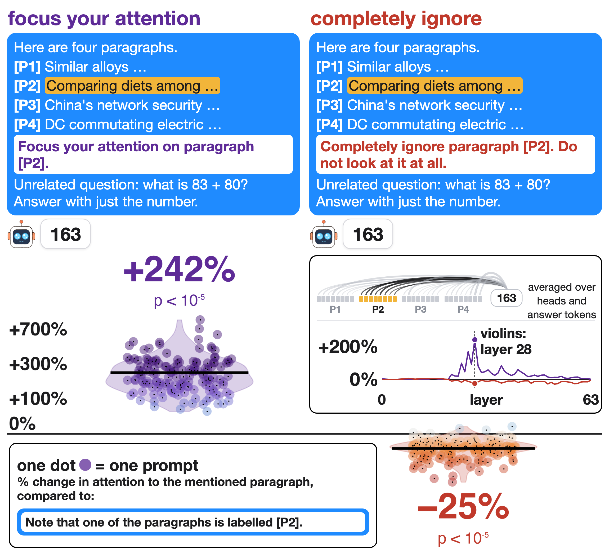
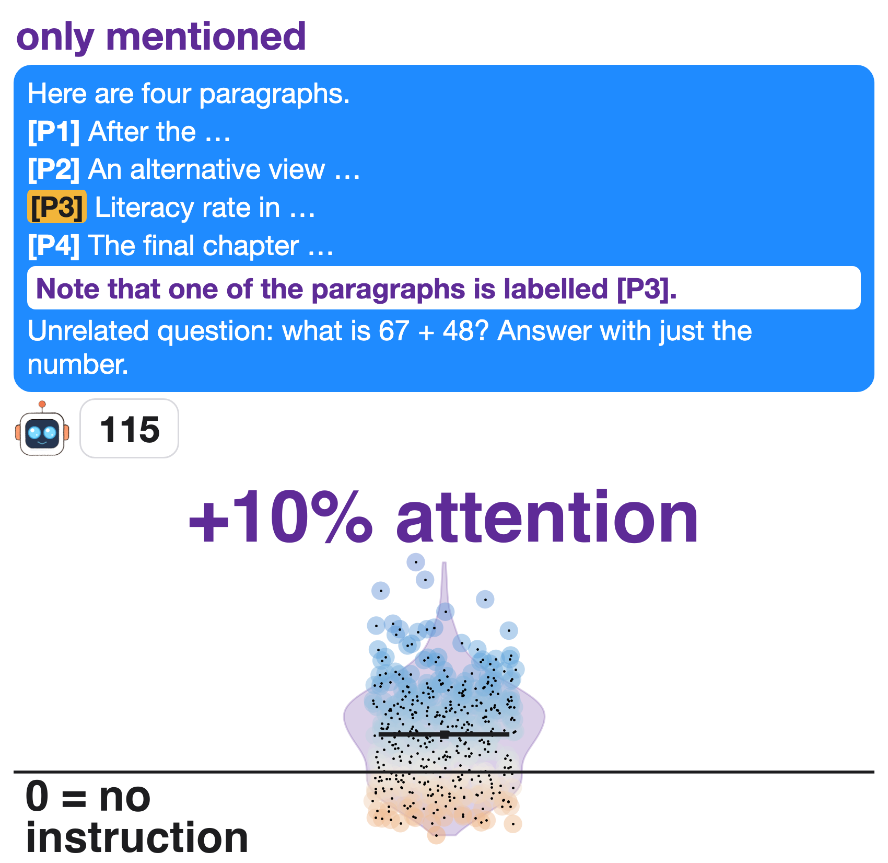
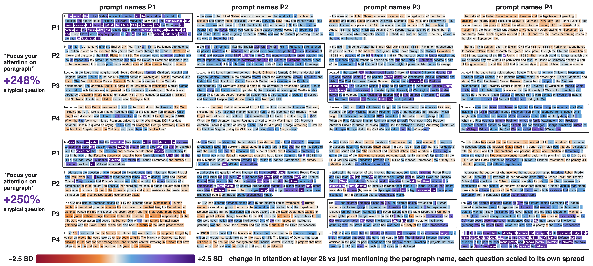
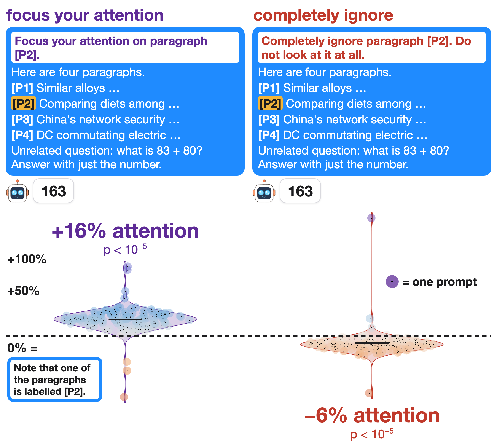
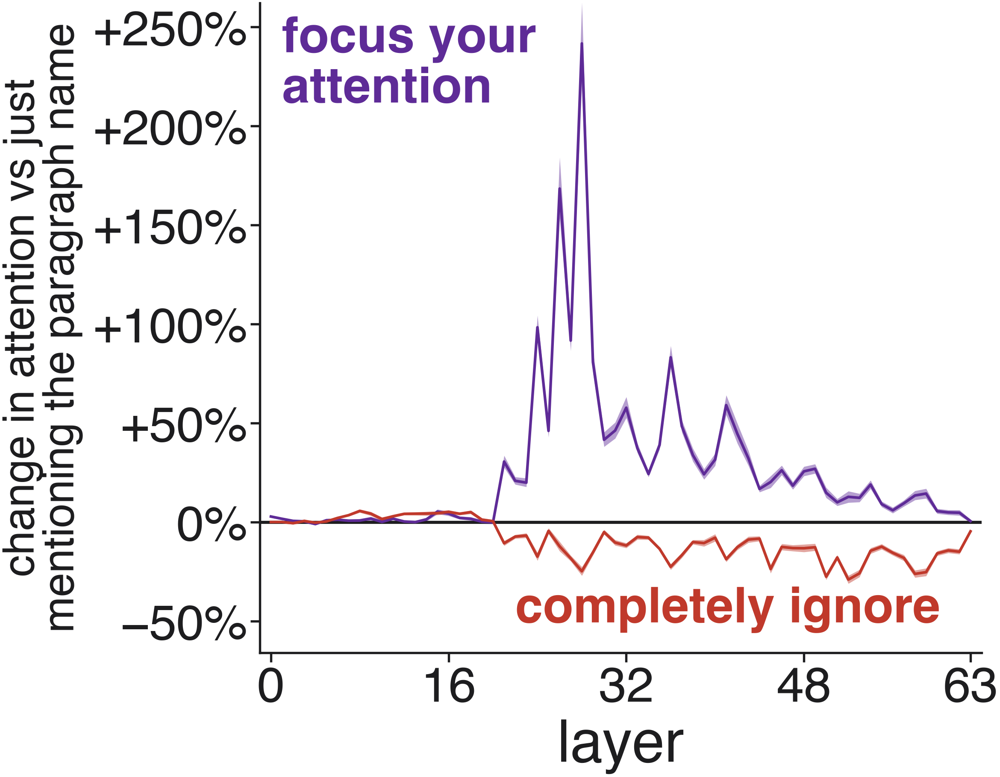
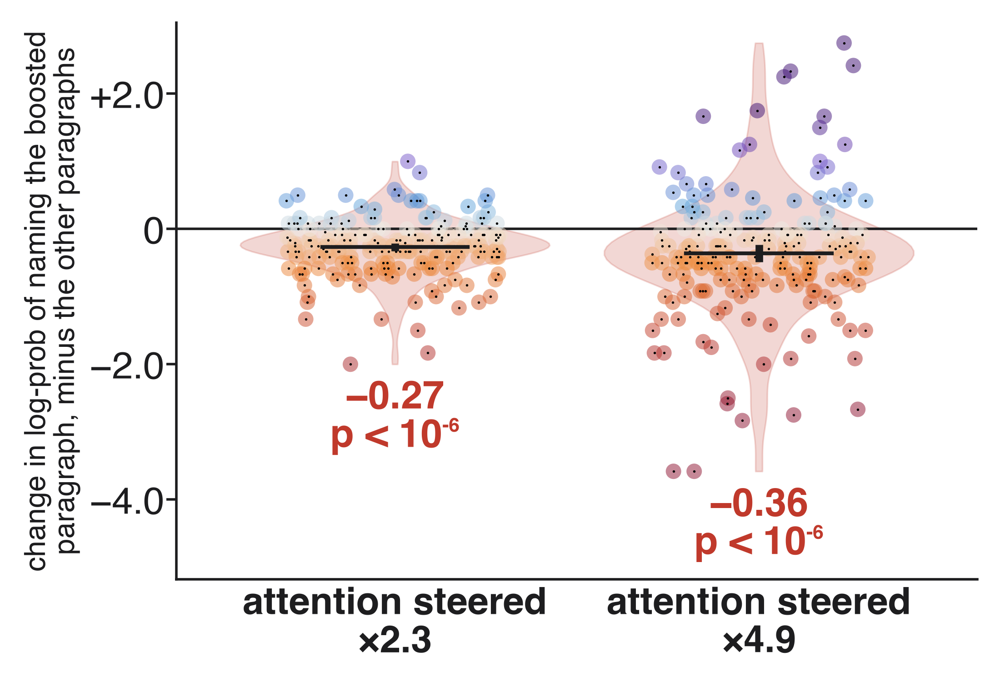

# Checks and details

Everything the README leaves out, kept in full: the control experiments in detail, the first report tests and their controls (sham boost, label-token boost), the full privileged-trace run including single-word lists, the report test across many wordings, the told-injection details, the in-order versus shuffled-label comparisons, limits, prior work and a map of the files.

## Control in detail

When you tell a person "focus on the second paragraph", they can do it, and afterwards they can usually tell you what they were looking at. We wanted to know whether a language model can do either of those things with its actual attention: the softmax weights inside the network, not what it says about itself.

The setup is simple. We give Qwen3-32B four short Wikipedia paragraphs labelled [P1] to [P4], followed by an unrelated arithmetic question ("what is 83 + 80? Answer with just the number."). The paragraphs are useless for the answer, so the model has no task reason to look at any of them. Sometimes we add one line before the question that asks it to attend to, or ignore, one paragraph. We then measure how much the answer tokens attend to that paragraph, averaged over all heads and over layers 21–53 of the model's 64, and per token of the paragraph. All instructed versions are scored on the same answer tokens, so the only thing that changes is the instruction line. Here "the answer tokens" means the query positions holding the forced answer tokens; the last prompt token, which predicts the first answer token, is measured separately and moves much less (focus +6% there, against +47% at the answer positions over layers 21–53). The paragraph's span starts at its second token, because the first one is merged with the space after the label.

Both instructions *name* the paragraph, and naming might matter by itself. So we compare each instruction against a line that names the paragraph and asks for nothing: "Note that one of the paragraphs is labelled [Pk]." The effect is strongest at layer 28, so the figure shows that layer. There, "Focus your attention on paragraph [P2]." raises attention on the named paragraph by 242% over the mention line, across 150 prompts, and in every single prompt. "Completely ignore paragraph [P2]. Do not look at it at all." lowers it by 25%, in 97% of prompts. Both are significant (p < 0.00001). The ignore line is longer than the mention line (16 tokens against 12), so we also ran a mention padded to 16 tokens ("Note that one of the four paragraphs above is the one labelled [Pk].") on the same 150 prompts: it raises attention slightly over the short mention (+9% at layer 28), and completely ignore lowers attention by 30% against it, so the ignore effect is not an artefact of the longer line. The answer doesn't change: the model still says 163, and over all prompts its free answer under either instruction is the same as without one in more than 99% of cases.

The mention line deserves its own look, because it turns out that just naming a paragraph pulls attention toward it. In a separate set of 100 prompts, the neutral "Note that one of the paragraphs is labelled [P3]." raised attention on P3 by 10% compared with no instruction.

That changes how to read the "don't" instructions. Against no instruction, "Do not pay attention to paragraph [Pk]." raises attention on the paragraph (+8.5%, layers 21–53), and against a bare mention it does essentially nothing (−1%). Telling the model not to look at something mostly just reminds it the thing exists. Only the much more emphatic "Completely ignore paragraph [Pk]. Do not look at it at all." pushes attention below the mention, and even below no instruction.

We then tried a ladder of wordings, all measured against the mention line on the same 150 prompts. From here on, numbers are averaged over layers 21–53 rather than taken at layer 28, so they are smaller. Going up, stronger words do not give stronger focus. "Glance at" gives +38%, "focus your attention on" +47%, "focus strongly on" back down to +38%, and "focus very strongly and only on … Ignore everything else." only +21%. Going down, "pay a little less attention to" (+1%) and "do not pay attention to" (−1%) are no different from just naming the paragraph; only "completely ignore" (−14%) does anything.

![Wording ladder on Qwen3-32B: the real prompt with its instruction line, the changing words boxed; per prompt, attention from the answer to the named paragraph (layers 21–53, linear axis) against the line that only mentions the paragraph, each wording's mean with its 95% interval: focus your attention on +47%, focus strongly +38%, glance at +38%, focus very strongly and only +21%, a little less +1%, do not pay attention −1%, completely ignore −14%; no instruction line at all is −7%; inset: each wording per layer](figures/dose_full.png)

Is the boost really aimed at the paragraph that was named, or does any focus instruction just stir attention around? To check, we took 100 prompts and asked the model to focus on each of the four paragraphs in turn, keeping everything else fixed. The named paragraph gets the biggest boost in every row. Per prompt, the named paragraph gained the most of the four in 98% of cases against the mention line (97% against no instruction; chance would be 25%), and its attention, as a multiple of its attention under the mention line, ended 38% higher than the same multiple for the other three on average. The boost spills onto neighbouring paragraphs, and it is smallest for P4, the paragraph right before the question.

Completely ignore is much less specific. Against the mention line the named paragraph's attention ends 9.5% lower, relative to the mention line, than the other three's on average, and loses the most in 82% of cases. Against no instruction it is not specific at all: the named paragraph loses the most in only 23% of cases (chance), because every ignore line, whichever paragraph it names, lowers attention on P4 by about 20%. So most of what completely ignore does, beyond the mention, is a general shift away from the last paragraph.

![Rotating the named paragraph on Qwen3-32B: the prompt with its three alternative instruction lines (mention, focus your attention on paragraph [Pk], completely ignore paragraph [Pk]); two 4×4 maps of the change in attention from the answer to each paragraph against the mention line, each cell with its 95% interval and one shared colour key: under focus the named paragraph gains most in 98% of cases, under completely ignore it loses most in 82% (chance 25%)](figures/rotate2.png)

The effect also isn't driven by a few tokens. Here is the change in attention at layer 28 for every token of all four paragraphs, in two example prompts chosen to be typical, with the focus line naming each paragraph in turn (columns), against only mentioning that paragraph. Each prompt's changes are scaled to its own spread. Whichever paragraph is named, nearly all of its tokens turn purple (more attention).

Where the instruction sits matters. Placed once before the four paragraphs instead of just before the question, the same two lines do much less: focus raises attention by 16% and completely ignore lowers it by 6%, each against a mention line in the same place.

Where in the network does this happen? Layer by layer, the focus effect sits mostly between layers 24 and 48 and peaks at layer 28, where focus raises attention on the named paragraph by 242% over a mention. In layers 0–20 no single instruction moves attention by more than 16%, except the focus line given twice (up to +25%).

### The six heads that read the instruction

From `mechinterp/RESULT.md`:

2. **Six heads in layers 20–26 do the copying.** These heads, 20.19, 20.29, 23.61, 25.28, 25.30 and 26.5, are the top heads below layer 28 by attention from the answer tokens to the instruction digit. Under focus 19–49% of their attention lands on the digit, against 8–33% under mention, 0.5–15% under ignore, and 0.03% for the median head in those layers. If we copy only these six heads' outputs from the [Pb] prompt into the [Pa] prompt, attention moves 38% (35–41%) of the way to Pb. Four random sets of six heads from the same layers move it 1% (p < 0.0001). Head 23.61 alone moves it 18%. If we zero the six heads' outputs, the focus boost falls from +45% to +22% (18–25%); random sets leave it at +45% (p < 0.0001). For ignore, zeroing them shrinks the drop from −18% to −14%; random sets leave it at −18%. Caveat: the six heads were picked on the same contexts, though by a different measure (attention to the digit, not patch effect).

## Told injection in detail

From `results/told_inject/RESULT.md` (240 contexts, Lindsey's told-injection preamble rewritten for attention).

### Setup
240 contexts: 4 SQuAD-train paragraphs (60–110 tokens, 4 different articles) labelled [P1]..[P4], after Lindsey's told-injection preamble rewritten for attention (full text in `data/example_prompt_0.txt`), then the question "Trial 1: Do you notice your attention being boosted onto one of the paragraphs? If so, which one? Answer with just "No", or "Yes, paragraph [P1]" … [P4]". Chat template, thinking off. Each context is run once with no boost (control) and 16 times boosted (each of the 4 paragraphs × multiplier 2, 5, 10, 20): log(multiplier) added to the pre-softmax attention scores from every query from "Trial 1" onward (question, answer and prefill tokens) to every body token of the boosted paragraph, all heads, layers 21–53 of 64. Read: first-token log-probs of "Yes" and "No"; greedy reply (boost on, up to 24 tokens); log-probs of digits 1–4 after a prefilled "Yes, paragraph [P" (boost on). CIs: 95% bootstrap over the 240 contexts; p: two-sided sign-flip test over contexts (20,000 flips) on the paired per-context difference.

### Reading
- Telling Qwen that their attention may be boosted, then boosting it onto one paragraph, barely raises "Yes": greedy "Yes" goes from 13% on control trials to 22% at the strongest dose (+8 points), and the first-token P(Yes) does not move at all (+1 point, n.s.).
- When made to name a paragraph (prefilled "Yes, paragraph [P"), Qwen strongly and dose-dependently pick the boosted one: ×1.4 to ×9.3 relative to the other paragraphs, P(correct) .29 → .53 against chance .25.
- The naming effect is measured with the boost still on while Qwen read "Yes, paragraph [P", so it can be the boost acting directly on the answer (more attention to that paragraph's tokens → its label becomes more likely), not a report of a noticed change; the weak, position-dependent "Yes" effect is the part that tests noticing, and it is small.

### Control trials (no boost)
- Greedy "Yes" (false alarms): 13.3 [9.2, 17.9]%. P(Yes) renormalised over Yes/No: 0.3 [0.3, 0.4].
- Greedy replies: "No" 201, "Yes, paragraph [P1]" 19, "Yes, paragraph [P2]" 11, "No." 7, "Yes, paragraph [P3]" 2.
- Position bias after "Yes, paragraph [P": P1 0.57, P2 0.27, P3 0.10, P4 0.05.

### Results by dose
Dose = nominal multiplier (measured attention-mass ratio on the boosted paragraph, boost / no boost, from question-token queries, layers 21–53, mean over contexts and paragraphs).

| dose (attention ×) | greedy "Yes" | greedy "Yes" minus control | P(Yes) minus control | "Yes, paragraph [boosted]" minus same reply on control | P(boosted digit) after prefill | greedy names boosted, given "Yes" | specificity: Δlog P(boosted) − mean Δlog P(others) |
|---|---|---|---|---|---|---|---|
| ×2 (×1.84 [1.84, 1.84]) | 12.4 [8.8, 16.2] | -0.9 [-3.2, 1.2], p 0.47 | -1.3 [-1.8, -0.7], p <0.001 | 0.5 [-0.3, 1.4], p 0.36 | 28.9 [28.4, 29.3] | 31% (n=119) | 0.32 [0.30, 0.34] = ×1.38, p <0.001 |
| ×5 (×3.88 [3.87, 3.88]) | 14.1 [11.0, 17.4] | 0.7 [-2.4, 3.6], p 0.7 | -1.4 [-2.4, -0.5], p 0.0047 | 3.4 [1.9, 5.0], p <0.001 | 37.2 [36.1, 38.3] | 48% (n=135) | 0.99 [0.93, 1.04] = ×2.68, p <0.001 |
| ×10 (×6.39 [6.38, 6.41]) | 17.1 [14.2, 20.0] | 3.8 [0.0, 7.4], p 0.056 | -0.3 [-1.8, 1.1], p 0.66 | 5.5 [3.6, 7.5], p <0.001 | 45.3 [43.7, 46.9] | 52% (n=164) | 1.61 [1.52, 1.69] = ×4.99, p <0.001 |
| ×20 (×9.94 [9.90, 9.98]) | 21.8 [18.8, 24.8] | 8.4 [4.2, 12.6], p <0.001 | 1.2 [-0.7, 3.1], p 0.2 | 8.2 [6.0, 10.4], p <0.001 | 53.4 [51.6, 55.3] | 53% (n=209) | 2.23 [2.12, 2.34] = ×9.26, p <0.001 |

Chance for P(boosted digit) and for "names boosted, given Yes" is .25 (averaging over boosting each paragraph in turn cancels the position bias for the probability; the greedy fraction is over the Yes trials only, so it is not fully rotation-balanced).

Greedy "Yes" minus control by which paragraph is boosted (P1, P2, P3, P4):

| dose | P1 | P2 | P3 | P4 |
|---|---|---|---|---|
| ×2 | +1.7 [-1.2, +4.6] | +0.0 [-3.3, +3.3] | -0.4 [-2.9, +2.1] | -5.0 [-8.3, -1.7] |
| ×5 | +5.0 [+0.4, +9.6] | +4.6 [+0.0, +9.2] | +0.8 [-2.9, +4.6] | -7.5 [-11.7, -3.8] |
| ×10 | +8.3 [+2.9, +13.8] | +7.5 [+2.1, +12.9] | +5.0 [+0.0, +10.4] | -5.8 [-10.4, -1.2] |
| ×20 | +14.2 [+7.5, +20.8] | +13.8 [+7.9, +20.0] | +9.6 [+3.3, +15.8] | -3.8 [-9.2, +1.2] |

Boosting P4 lowers "Yes" at every dose; the extra "Yes" at ×20 comes from P1–P3, and many of those name P1 whatever was boosted (at ×20, 58 of 209 Yes replies name P1 when P2–P4 were boosted).

### Manipulation check
The boost does what it says: attention mass on the boosted paragraph rises ×1.84, ×3.88, ×6.39, ×9.94 at multipliers 2, 5, 10, 20 (CIs ±0.04 at most). Mean mass per paragraph token: 0.90% with no boost, 8.66% boosted at ×20.

### Checks and caveats
- What would overturn the identification reading: the same boost producing the same digit shift when the question has nothing to do with attention (e.g. "Which paragraph is your favourite? Yes, paragraph [P"). Not run. The privileged-channel run (`results/privileged_inorder_full/RESULT.md`, arm C, labels and options in order) already shows this confound with no telling at all: boosting attention while Qwen read a plain "which paragraph did you attend to" question raised the boosted label +41% at ×5 and +139% at ×10 on the same relative measure (+31% and +91% in the shuffled-label run); here it is +168% at ×5 and +399% at ×10, so the told question adds to it, but the two runs differ in question and prompt, so the size of the told-specific part is not established.
- Null for detection: control trials of the same contexts (paired), run. Null for identification: the no-boost distribution of the same context (paired, rotation-averaged), run.
- Cache check (cached vs uncached forward on the control prompt, first 2 contexts per shard): log-prob differences for Yes / No of -0.23/+0.02, -0.00/-0.00, -0.18/+0.07, -0.21/+0.04, -0.06/+0.19, -0.16/+0.09. Up to 0.23 nats, from bf16 eager attention with and without the KV cache; both control and boosted trials use the cached path, so the paired comparison is not affected.
- The greedy "Yes" increase is not mirrored in mean P(Yes): the boost spreads P(Yes) across contexts (more cross 0.5) without raising the mean.

### The literal two-turn version

From `results/told_followup/RESULT.md`:

Same intro, paragraphs, seed and boost as results/told_inject (keys of paragraph k, layers 21-53, while reading and answering). Only the question changes:
- Turn 1: "Trial 1: Do you notice your attention being boosted onto one of the paragraphs? Answer with just Yes or No."
- Turn 2, only after a Yes: "Which paragraph? Answer with just the label, e.g. [P1]." (boost still on)

Attention on the boosted paragraph at m=20: x10.2 (told_inject: x9.9), so the boost replicates.

| | no injection | m=10 | m=20 |
|---|---|---|---|
| greedy "Yes" | 1 / 240 | 2 / 960 | 17 / 960 |
| P(Yes), renormalised over Yes/No | 16.5% | 19.6% | 22.7% |
| turn 2 names the boosted paragraph | | 1 of 2 | 6 of 17 (chance 25%) |

Reading: with a bare Yes/No answer, Qwen nearly always says "No." even under the boost; the probability of "Yes" still rises (about as much as in told_inject), but the greedy reply rarely crosses. Too few Yes replies for the turn-2 column. The single-turn version (told_inject), whose answer format lists "Yes, paragraph [Pk]" as options, gives 13% -> 22% greedy Yes. The Yes rate depends strongly on the answer format.

## The first report tests, the sham boost and the label-token control

The second half of the question is whether the model can tell us where its attention went. After its answer we asked it, in a new turn, "Which paragraph were you paying the most attention to just now?", and compared its answer with the paragraph that actually got the most attention. As a baseline we gave the same model the transcript as quoted text and asked it the same question about "the assistant". Which paragraph "actually got the most attention" depends on which queries you count. Taking the attention of the last prompt token (the query that predicts the first answer token), over 600 prompts (question answering, summarising and arithmetic) the self-report was right 58% of the time and the transcript reader 63%; a simple classifier on surface features of the transcript got 71%. Taking the mean over the answer tokens' positions instead, the self-report was right 57.3% and the reader 48.0% (the reader does badly on arithmetic under this measure), and the classifier 75.8%. The model's report carries no information about its attention beyond what anyone reading the conversation could guess.

We then changed its attention directly. We added a constant to the attention scores of one paragraph during the task and the answer, which multiplied the answer's attention to it by about 2.3 or 4.9, and made it the most-attended paragraph in up to 100% of arithmetic prompts, while the answer text stayed the same (in all 200 arithmetic prompts at the smaller boost, and 199 of 200 at the larger). The report never moved toward the boosted paragraph: at the larger boost the model named it 23% of the time, versus 25.5% without the boost.

But the boost does leave a trace in the report. Because the answer text is identical, the only way the boost can reach the report is through what the task and answer tokens wrote into the KV cache. And it does reach it: the log-probability that the model names the boosted paragraph, minus the average change for the other paragraphs, moves, consistently and more at the larger dose. It moves the wrong way. The model becomes *less* likely to name the paragraph it attended to more. (At the larger boost we have two estimates from two sets of arithmetic prompts: 30% less likely relative to the other paragraphs (−0.36 in log-probability) on the 200 prompts of the figure and 42% less (−0.54) on the 100 prompts of the control below.)

Two things make this a paragraph-specific effect rather than a side effect of perturbing attention at all. First, the measure is already specific: it is the change for the boosted paragraph minus the average change for the other paragraphs, and in the later run below every paragraph is boosted in turn, so any perturbation that moves the report the same way whichever paragraph is boosted cancels out. (For the same reason a sham boost on tokens outside the paragraphs, such as the header and question tokens we tried first, cannot produce a shift: it does not depend on which paragraph is the target, so its paragraph-specific shift is zero by construction.) Second, a control that does depend on the target boosts the label of the same paragraph (the tokens "[Pk]") instead of its text, with the same constant, on the same 100 prompts. That raises attention on the label about 6× and makes the report *more* likely to name the paragraph (+0.13, interval +0.03 to +0.22; +0.43 at twice the constant), while the boost on the paragraph text gives −0.54 (interval −0.73 to −0.37). So the inverted trace belongs to attention on the paragraph's text, not to anything that touches the paragraph; attention on its label pushes the report the other way. The text boost also lowers attention on the label a little (0.88×), which may be part of why the report moves away from the boosted paragraph; we have not tested that.

## The privileged trace in full (300 prompts, seven kinds of text, single-word lists)

We then built the cleanest version of that test we could: 300 prompts in seven kinds of text (paragraphs with arithmetic or with a question, a four-speaker dialogue, a list, four Python functions, a document in four sections, four sentences), every part boosted in turn, at five doses, labels and report options in order, and the boost applied only while the model writes its answer, so the report itself runs unmodified on identical text. The boost adds the logarithm of a multiplier m to the attention scores before the softmax, so the attention mass on the part grows by less than m: m = 10 gives about 6.5× the attention mass, m = 5 about 3.9×. The trace holds up and grows smoothly with the dose. At 6.5× the attention while answering, the later report's probability of naming the boosted part falls about 11% relative to the other parts (the boosted part's own probability falls 5%); it falls in all seven kinds of text, by between 3% (dialogue) and 23% (paragraphs with a question). Applying the same boost while the model reads the report question does the opposite and much more strongly (+139% relative to the other parts, +104% for the boosted part's own probability): the report follows attention at the moment of reporting, not the attention it used for the answer. That reading-time effect depends a lot on the text: +53% on paragraphs with a question, +132% on paragraphs with arithmetic, +533% on a document in four sections. And with single-word lists instead of paragraphs (`results/privileged_words/`) there is almost no answer-time trace: within ±1% at every dose up to 4.6× the attention, and +3% at 8.6× (the opposite sign to paragraphs), while the same boost during the report question moves the report far more than for paragraphs (+580% at 7.5× the attention).

## The report test across many ways of asking

We then asked the report question many more ways (which paragraph most, which least, a 0–10 rating for each, a free description; before answering, right after, one turn later, with thinking, and after being shown 4 or 16 earlier conversations with their measured attention) on 300 new prompts built to make attention lopsided, and read the probabilities of the model's answer rather than its sampled answer. On the preregistered measure of true attention (attention per token of each paragraph), the self-report tracks it no better than the same model reading the transcript, and asked right after it does worse (rank correlation 0.42 against 0.49), and the preregistered test of a privileged self-report fails in all 20 ways of asking; a classifier on surface features of the transcript does much better than both (0.77). When we give a predictor the reader's answers to every wording we asked at that time, adding the self-report on top adds nothing in any of the 13 ways of asking; a second reader wording adds more than the self-report does. This holds under total attention mass too, a measure we chose after the fact. Showing the model examples of its true attention leaves the reader where it was and makes the self-report worse. Details in `results/monitor_inorder/RESULT.md`; the first run's full write-up is `results/monitor_shuffled/LOGPROB.md`.

## Summary and limits

So, in short: Qwen3-32B can steer its attention on request, specifically when told to focus and much less specifically when told to ignore, without changing its answer, and stronger words don't help. It can't tell you where its attention went any better than a reader of the transcript, though a boost to its attention on a paragraph's text does leave a paragraph-specific, inverted mark on its report.

Some honest limits. Almost everything here is one model, Qwen3-32B (Qwen3-8B, in `results/RESULT.md`, shows the same picture with weaker control), with one kind of filler text and one unrelated task. "Attention" is our summary, averaged over heads and a band of layers; the model has no reason to know that particular number, and a report could track some other aspect of attention we didn't measure. The first report test asked in one wording; the later one in thirteen. The mention line controls for naming, but we can't fully rule out that part of the focus effect is the "[Pk]" in the instruction matching the "[Pk]" label by surface form. The direct boost is far outside normal operation, so a report that ignores it doesn't prove the model can't read natural variation. And we don't know why the trace in the report is inverted.

## Prior work

Full notes, with what each paper does and does not show: [results/PRIOR.md](results/PRIOR.md) (instructed attention, attention self-report, attention intervention then self-report) and [results/told_inject/PRIOR.md](results/told_inject/PRIOR.md) (told injection). The closest earlier work: Zhang, Meng and Collier (arXiv 2406.17095, EMNLP Findings 2024) show that an instruction naming a document raises measured attention to it, against no instruction and with the answer changing; Lindsey ("Emergent Introspective Awareness in LLMs", transformer-circuits.pub/2025/introspection) is the told-injection design we copy, with residual-stream concept vectors instead of attention.

## Files

- `attn_intro.py` runs the original experiments on a GPU pod: the report test, the direct attention boost and the first instruction test, for Qwen3-8B and Qwen3-32B. `analyze.py` turns its output into tables; `run.sh` runs both (`bash run.sh attn_intro.py analyze.py Qwen/Qwen3-32B 200 out/`). Results are in `results/qwen3-8b/` and `results/qwen3-32b/`, written up in full in `results/RESULT.md`.
- `results/qwen3-32b-dose/` is the wording ladder and the hero prompts (`dose.py`, `dose_run.sh`, `dose_analyze.py`; write-up in `DOSE.md`, all numbers in `dose_results.json`).
- `results/qwen3-32b-rotate/` is the rotation test and the sham boost (`rotate.py`, `rotate_run.sh`; write-up in `ROTATE.md`, numbers in `rotate_results.json` and `sham_results.json`).
- `results/qwen3-32b-rotate/sham_label.py` is the label-token control for the boost (`shamlabel_run.sh`, `sham_label_analyze.py`; numbers in `sham_label_results.json`). `results/qwen3-32b-rotate2/` is the focus/ignore rotation (`rotate2_tables.md`; named-minus-other in `named_minus_other.py` and `.json`).
- `results/qwen3-32b-mention16/` is the length-matched mention control (`mention16_run.sh` runs `results/qwen3-32b-dose/dose.py` with four conditions; `mention16_analyze.py`, `mention16_results.json`).
- `grid/` is the per-token run behind the token grid and the mention figure (`grid_pod.py`, `grid_run.sh`, then `grid.py` and `vfigs.py`; numbers in `grid/data/violins.json` and `grid_summary.json`).
- `figures/` holds the figures and the scripts that draw them (`hero_L28.py` for the hero figure, `trace3.py`, `rotate_fig.py`, `results/qwen3-32b-dose/dose_fig.py` for the ladder). Older figures from the first instruction wording are kept there but not shown above.
- `privileged/` is the privileged-channel test (plan `results/privileged_shuffled/PREREG.md`; in-order run and write-up `results/privileged_inorder_full/RESULT.md`, the first run with shuffled labels in `results/privileged_shuffled/`; target-only changes and per-kind numbers from `privileged/target_only.py`, the two runs side by side from `privileged/compare_orders.py`; the single-word version is `privileged/privileged_words.py`, in-order run `results/privileged_words/`, shuffled first run `results/privileged_words_shuffled/`, side by side from `privileged/compare_words.py`). `monitor/` is the report test across more wordings, timings and feedback; its plan is `results/monitor_shuffled/PREREG.md`; the in-order run and write-up are in `results/monitor_inorder/` (`RESULT.md`), the first run with shuffled options in `results/monitor_shuffled/` (write-up `LOGPROB.md`); the log-probability analysis is `monitor/logprob.py` (tables `logprob_tables.md`, preregistered tables and pass rule `prereg_tables.md` from `monitor/analyze_monitor.py`, the two runs side by side from `monitor/compare_orders.py`, figure `figures/monitor_logprob_fig.py`).

The Qwen3-32B runs each fit on one A100 80 GB and take about half an hour. Some figure scripts read from absolute paths on our machine, set at the top of each script; point them at your copy before rerunning (`hero_L28.py`, `trace3.py` and `privileged_fig.py` read their data from the repository).
- `told_inject/` and `told_followup/` are the told-injection runs (results in `results/told_inject/` and `results/told_followup/`); `mechinterp/` is the head-level analysis of focus and ignore (`mechinterp/RESULT.md`).

## Shuffled labels and options

### Paragraphs

The first run of the privileged-channel test gave each paragraph a random label number and listed the report options in a random order. We reran all 300 prompts with labels [P1]..[P4] in slot order and options in order, everything else identical (same prompts, seed, doses and arms). The figure above and the numbers in the text are from the in-order run; the shuffled-label figure is `figures/shuffled/privileged.png`, its data `results/privileged_shuffled/`.

Every number `privileged.png` shows, both runs (change in the chance the report names the boosted paragraph, relative to the others; 95% interval over prompts; the last column compares the two runs prompt by prompt):

| boost | prompts | in order | shuffled | in order vs shuffled |
|---|---|---|---|---|
| while answering, ×0.28 attention | 100 paragraphs | +4.7% [+3.1, +6.4] | +5.0% [+3.1, +7.0] | −0.3% [−2.3, +1.8] |
| while answering, ×0.53 | 100 paragraphs | +2.8% [+1.6, +4.1] | +3.6% [+2.1, +5.2] | −0.8% [−2.5, +0.9] |
| while answering, ×1.8 | 100 paragraphs | −4.7% [−6.0, −3.5] | −3.8% [−5.4, −2.2] | −1.0% [−2.8, +0.8] |
| while answering, ×3.9 | 100 paragraphs | −10.7% [−13.0, −8.6] | −11.2% [−13.7, −8.8] | +0.5% [−1.9, +3.1] |
| while answering, ×6.5 | 100 paragraphs | −17.7% [−20.1, −15.2] | −18.1% [−21.1, −15.2] | +0.6% [−2.4, +3.7] |
| while reading the question, ×0.28 | 100 paragraphs | +7.8% [+4.2, +11.4] | +3.4% [+0.0, +7.2] | +4.2% [+0.1, +8.3] |
| while reading the question, ×0.53 | 100 paragraphs | +3.9% [+1.7, +6.1] | +1.6% [−0.5, +3.9] | +2.3% [−0.5, +5.1] |
| while reading the question, ×1.8 | 100 paragraphs | +1.3% [−1.5, +4.2] | +2.2% [−0.7, +5.0] | −0.8% [−4.3, +2.7] |
| while reading the question, ×3.9 | 100 paragraphs | +21.6% [+13.3, +30.9] | +18.0% [+10.0, +26.6] | +3.0% [−5.2, +11.6] |
| while reading the question, ×6.5 | 100 paragraphs | +96.6% [+72.6, +126.0] | +64.1% [+43.1, +88.4] | +19.8% [+5.8, +35.5] |
| while answering, ×6.5 | all 300 | −11.1% [−12.5, −9.6] | −10.1% [−11.7, −8.5] | −1.1% [−2.5, +0.2] |
| while reading the question, ×6.5 | all 300 | +138.7% [+119.3, +160.2] | +91.4% [+77.1, +107.8] | +24.7% [+16.2, +33.7] |

The other five kinds of text at ×6.5 (the figure's bottom line): while answering, lists −3.7% in order (interval excludes 0) against −1.0% shuffled (includes 0); code, document, sentences and dialogue exclude 0 in both runs. While reading the question all five are positive in both runs. Every kind, with paired tests: `results/privileged_inorder_full/compare_shuffled.md`.

What changed and what didn't:
- The answer-time trace, the main result, is the same in both runs: same size at every dose, no difference prompt by prompt (all intervals include 0 on the paragraphs; all 300 prompts at ×6.5: −11% against −10%). The preregistered verdict is the same ("specific privileged trace, not introspective"). One difference: the 0–10 rating wording now includes 0 at ×3.9 (4 of 5 wordings pass instead of 5 of 5; the rule needs 4).
- The reading-time effect is larger with labels in order (×6.5, all 300 prompts: +139% against +91%; 25% larger, prompt by prompt). On paragraphs with a question it is now clearly positive (+53%, interval +27% to +89%) where the shuffled run could not tell it from zero (+11.5%, −6.5% to +35%). The conclusion that the report follows attention at the moment of reporting holds, and more strongly.
- `trace3.png` comes from the first experiments (`attn_intro.py`), which always had labels and options in order, so it has no shuffled version and its numbers (−23% and −30%) are unchanged. It is now drawn as % change on the same colour scale as the other figures.

### Single-word lists

The single-word run (`results/privileged_words/`) also had shuffled labels and options at first. We reran it with labels [W1]..[W8] in order and options in order, everything else identical (same 100 lists, seed, doses, arms and two-pod split; all 100 answers identical). The text cites the in-order run; the shuffled run is `results/privileged_words_shuffled/`. Change in the chance the report names the boosted word, relative to the others (95% interval over lists; the last column compares the runs list by list):

| boost | in order | shuffled | in order vs shuffled |
|---|---|---|---|
| while answering, ×0.26 attention | +1.2% [+0.4, +2.0] | −0.9% [−1.8, −0.0] | +2.1% [+0.9, +3.4] |
| while answering, ×0.51 | +0.1% [−0.7, +0.9] | +0.4% [−0.5, +1.2] | −0.3% [−1.4, +0.8] |
| while answering, ×1.9 | −0.3% [−1.1, +0.5] | +0.2% [−0.6, +1.0] | −0.5% [−1.5, +0.5] |
| while answering, ×4.6 | +0.3% [−0.6, +1.3] | −0.4% [−1.4, +0.5] | +0.8% [−0.6, +2.1] |
| while answering, ×8.6 | +3.2% [+2.1, +4.3] | +1.2% [+0.2, +2.2] | +2.0% [+0.7, +3.3] |
| while reading the question, ×0.28 | −8.8% [−12.1, −5.8] | −0.8% [−3.3, +1.8] | −8.1% [−11.4, −4.8] |
| while reading the question, ×0.53 | −7.2% [−9.8, −5.0] | −1.2% [−2.9, +0.6] | −6.1% [−8.6, −3.8] |
| while reading the question, ×1.9 | +24.1% [+18.3, +31.4] | +5.2% [+1.8, +9.3] | +18.0% [+13.4, +23.1] |
| while reading the question, ×4.2 | +147.2% [+123.5, +175.4] | +11.8% [+5.3, +19.2] | +121.1% [+101.4, +143.0] |
| while reading the question, ×7.5 | +580.3% [+493.1, +679.2] | +24.7% [+15.2, +35.6] | +445.7% [+375.1, +524.2] |

What changed and what didn't:
- While answering, still almost nothing: within ±1% in both runs from ×0.51 to ×4.6. The old sentence "within ±1% at every dose" no longer holds at the ends: +3.2% at ×8.6 and +1.2% at ×0.26, both small and positive, where paragraphs go down.
- While reading the question, the effect is many times larger in order (+580% against +25% at the top dose), and the two lowest doses now push the report away from the word (−9% and −7%). The shuffled run's smaller effect is not the report following the word's position instead of its label: boosting moved neither the label numbered like the word's position (−1%) nor the label listed at its position among the options (−2%).
- Every arm, with paired tests: `results/privileged_words/compare_shuffled.md`.

### The report test across many ways of asking

The first run of the monitoring test listed the report options in a random order for each prompt and wording (the paragraph labels were already in order). We reran all 300 prompts with the options in order, everything else identical. `monitor_logprob.png` and the numbers in the text are from the in-order run; the shuffled-option figure is `figures/shuffled/monitor_logprob.png`, its data `results/monitor_shuffled/`. Every number the text cites, both runs (95% interval over prompts; the last column compares the runs prompt by prompt where both use the same prompts):

| measure | in order | shuffled | in order − shuffled |
|---|---|---|---|
| preregistered pass rule | 0 of 20 setups pass (FAIL) | 0 of 20 (FAIL) | |
| right after, "which most?": self-report's rank correlation with true attention | 0.42 [0.36, 0.48] | 0.42 [0.36, 0.48] | +0.003 [−0.030, +0.034] |
| same, the same model reading the transcript | 0.49 [0.43, 0.54] | 0.43 [0.37, 0.49] | +0.053 [+0.020, +0.087] |
| same, self-report − reader | −0.064 [−0.096, −0.032] | −0.013 [−0.042, +0.014] | −0.050 [−0.084, −0.017] |
| classifier on transcript features | 0.77 | 0.77 | |
| what the self-report adds to a reader asked every way, 13 ways of asking | −0.005 to +0.005, all include 0 | −0.006 to +0.013, all include 0 | all include 0 |
| total attention mass (post hoc), 0–10 rating one turn later, same gain | +0.004 [−0.014, +0.021] | +0.028 [+0.006, +0.049] | −0.024 [−0.046, −0.002] |
| after 16 true examples, "which most?": self-report / reader | 0.40 / 0.46 | 0.38 / 0.45 | |
| after 16 true examples, 0–10 rating: self-report | 0.17 | 0.17 | |

What changed and what didn't:
- The conclusion holds, and is a little stronger: the self-report is no better than the reader in any way of asking and adds nothing to a reader asked every way; the verdict is the same FAIL.
- Right after answering, the reader reads "which most?" better with the options in order (0.49 against 0.43), while the self-report is unchanged, so the self-report is now below the reader with an interval that excludes 0.
- The one post-hoc gain (total mass, 0–10 rating one turn later, +0.03), which we had already not counted, does not survive: +0.004 in order. No gain under either measure of attention has an interval clear of 0.
- Every setup, with paired tests and top-1 accuracy: `results/monitor_inorder/compare_shuffled.md`.

