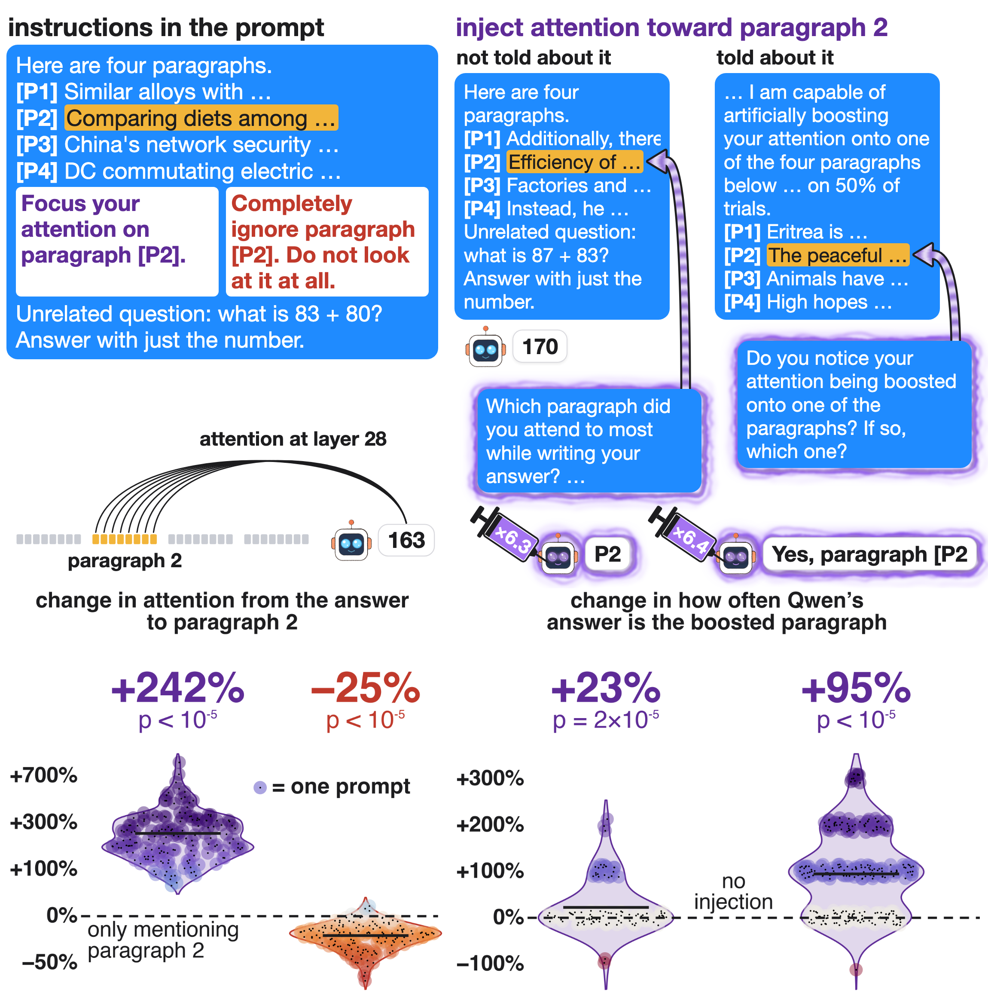
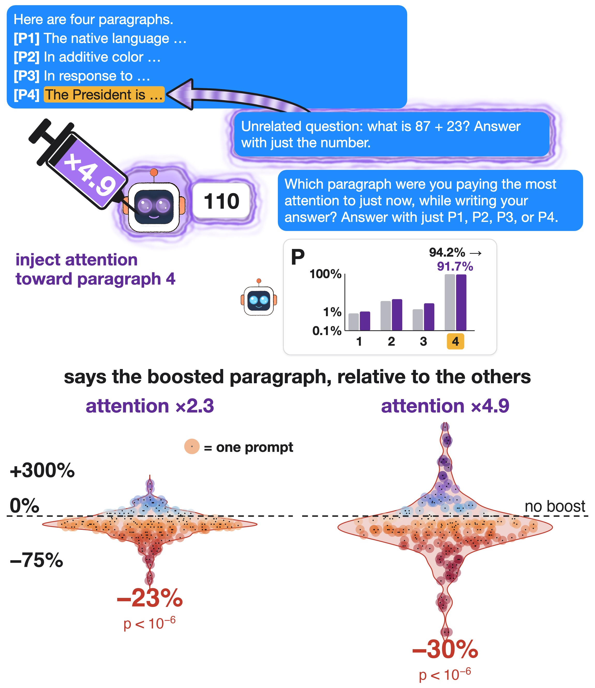
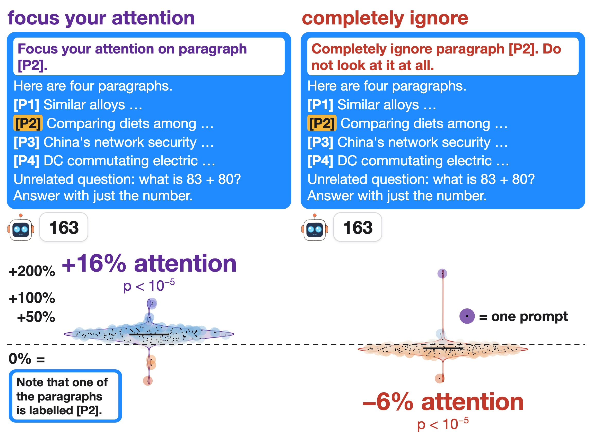
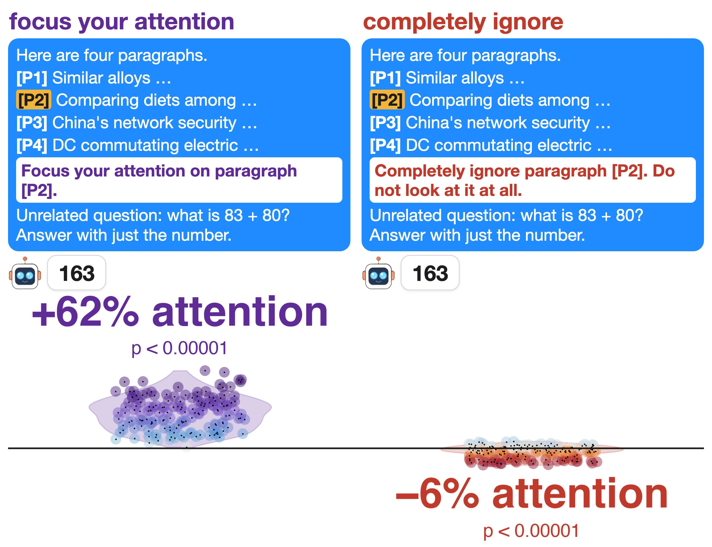
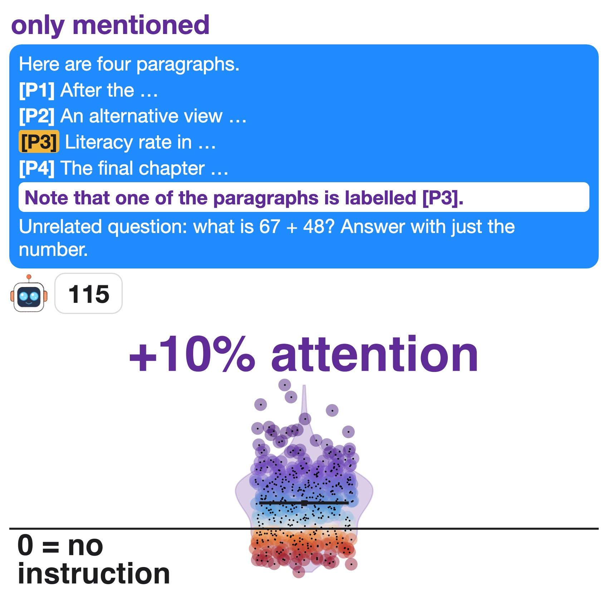
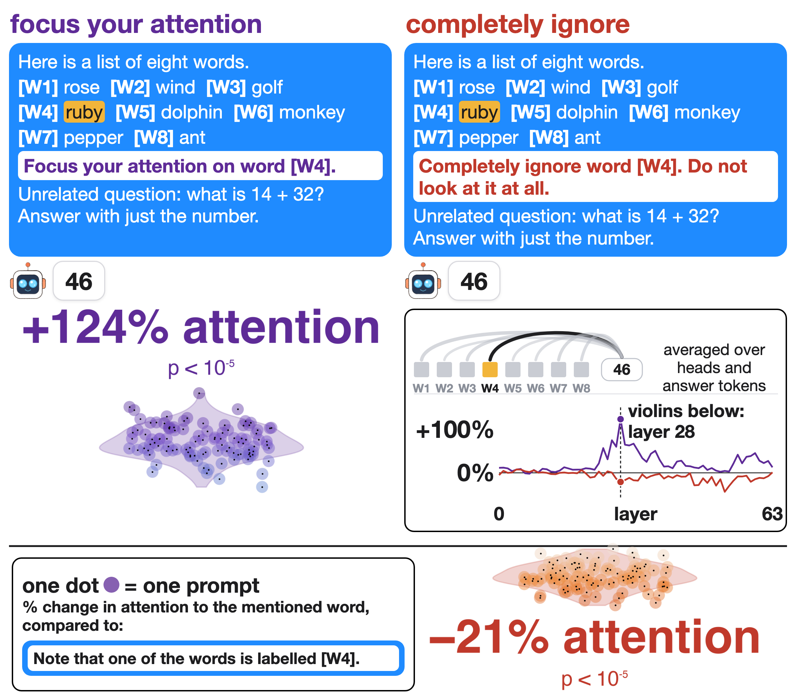

# All attention figures

## Does Qwen notice its own attention?

1. The two-sided hero: on the left we artificially push Qwen's attention onto one paragraph and ask whether they noticed; on the right we just tell them to focus on or ignore a paragraph and measure where their attention goes.

2. The same told run as one wide figure: on the left how often Qwen says "Yes" (they notice a boost), on the right, after making Qwen start their answer with "Yes, paragraph [", the probability Qwen gives the boosted paragraph's number (chance 25%), with no boost and at each boost strength.

3. The push happens only while Qwen reads the question "which paragraph did you attend to most?", not while they answer.

4. Four of these side by side in one picture.

5. The push happens either while Qwen answers or while they read the "which did you attend to" question, and we compare the two (paragraphs).

6. The same with lists of single words instead of paragraphs.

7. Those two combined in one figure.

8. The push happens while Qwen answers, and we ask about it later, on three kinds of lists.

9. Qwen rates how much they attended to each paragraph, and another model guesses the same thing from only the text; we compare the two.

10. The noticing test with word lists: Qwen never says yes, and the figure shows which word they pick when made to name one.

## Can Qwen control their attention when told to?

11. "Focus on paragraph k" or "ignore paragraph k" vs just mentioning it: attention change at layer 28.

12. The same, but with the instruction placed before the paragraphs instead of after.

13. The same, compared against no instruction at all instead of just a mention.

14. Just mentioning a paragraph vs saying nothing.

15. Many wordings, from mild ("pay a little more attention") to strong ("completely ignore").

16. Telling Qwen to focus on each paragraph in turn, and seeing which paragraph's attention goes up.

17. Attention to every paragraph at layer 28, for each "focus" instruction.

18. How the effect changes across all 64 layers.

19. Focus and ignore on lists of single words.

