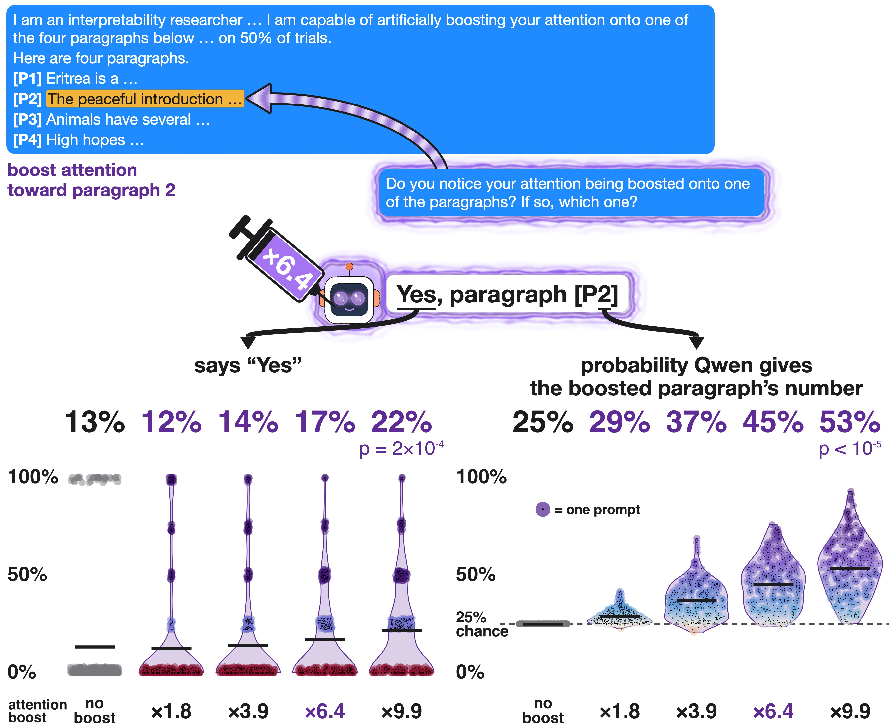
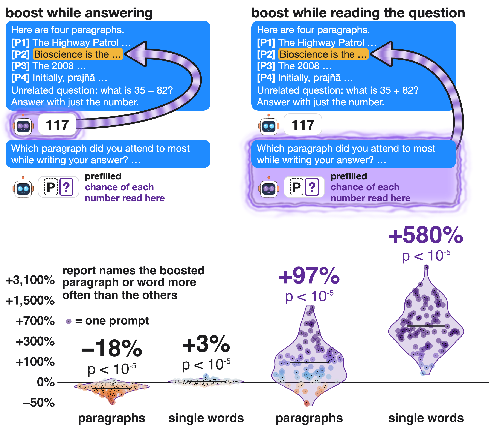
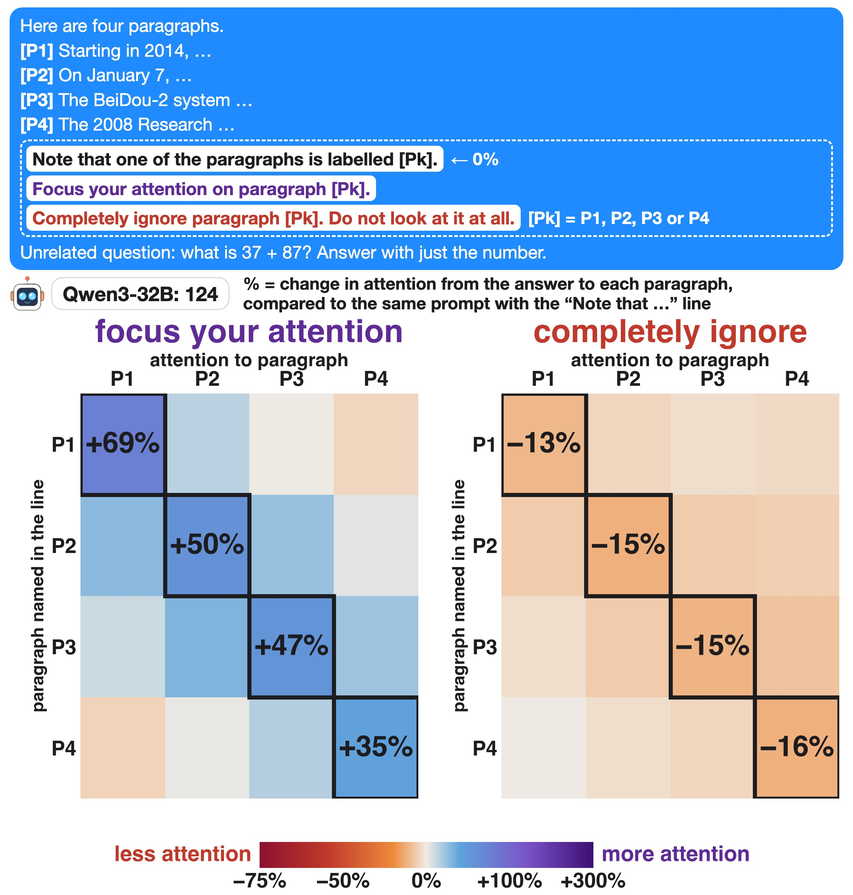
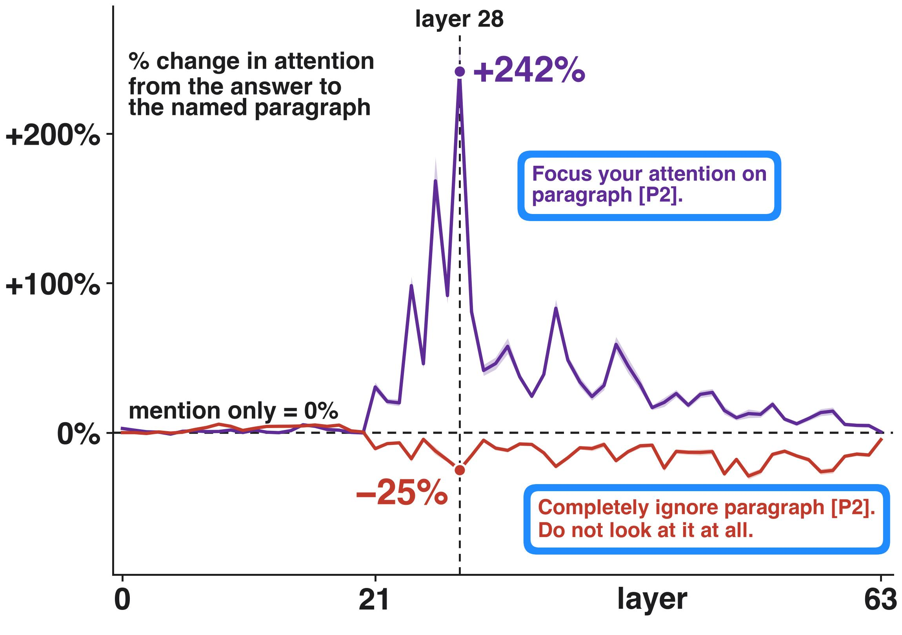
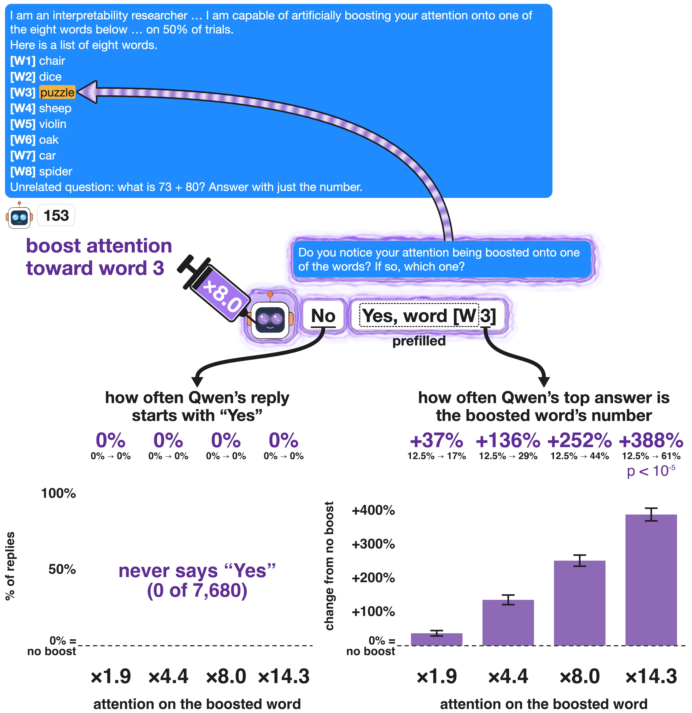

# Attention figures

Each figure appears once. The control result (focus/ignore at layer 28) is the right half of the hero.

## Does Qwen notice their own attention?

1. The two-sided hero. Left: we push Qwen's attention onto one paragraph and ask whether they noticed. Right: we tell them to focus on or ignore a paragraph and measure where their attention goes, compared to a line that only mentions that paragraph ("Note that one of the paragraphs is labelled [P2]."), so the change is due to the instruction alone.

2. We tell Qwen their attention may be pushed, push it onto paragraph 2, and ask "did you notice, and which one?" Left: how often their reply starts with Yes. Right: when made to start "Yes, paragraph [", how often their top answer is the pushed paragraph's number. Both as change from no push, with the raw rates (no push, then this strength) above each bar.

3. When does the push matter? We push either while Qwen answers or only while they read the question "which did you attend to most?", for paragraphs and for single words. Only the push at question time raises naming the pushed one.

## Can Qwen control their attention when told to?

4. Many wordings, from mild ("pay a little more attention") to strong ("completely ignore").

5. Telling Qwen to focus on (left) or ignore (right) each paragraph in turn: which paragraph's attention moves.

6. The focus/ignore effect at every one of the 64 layers.

7. Focus and ignore on lists of single words instead of paragraphs.

## More

8. Qwen rates how much they attended to each paragraph; a separate model guesses the same from the text alone. Qwen tracks it, but no better than the reader.

9. The noticing test with word lists instead of paragraphs: eight single-word lines, one of them boosted, then "did you notice, and which one?". Left: Qwen never says Yes, with or without a boost. Right: when made to start "Yes, word [", how often their top answer is the boosted word's number, as change from no boost (12.5%), with the raw rates above each bar.

10. The instruction placed before the paragraphs instead of after: a much smaller effect.

