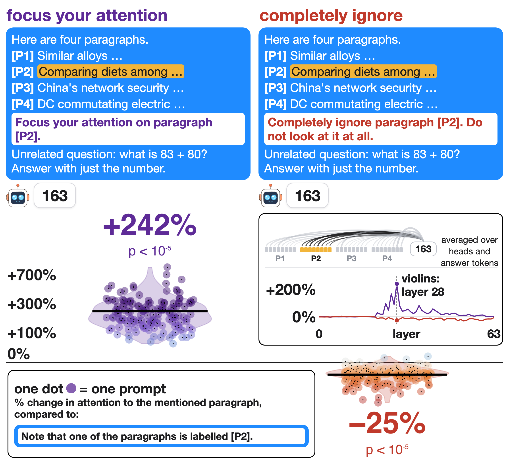
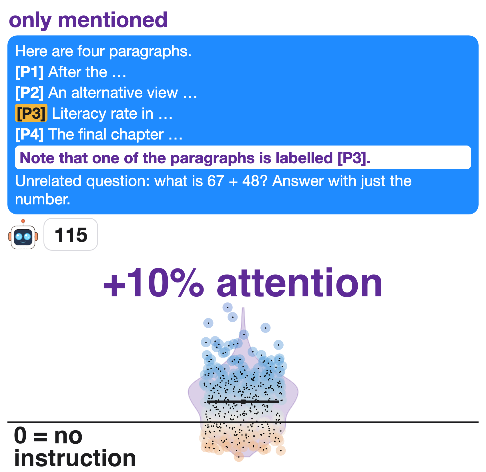
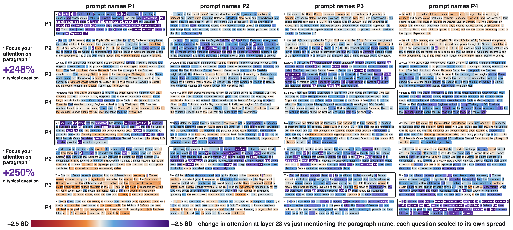
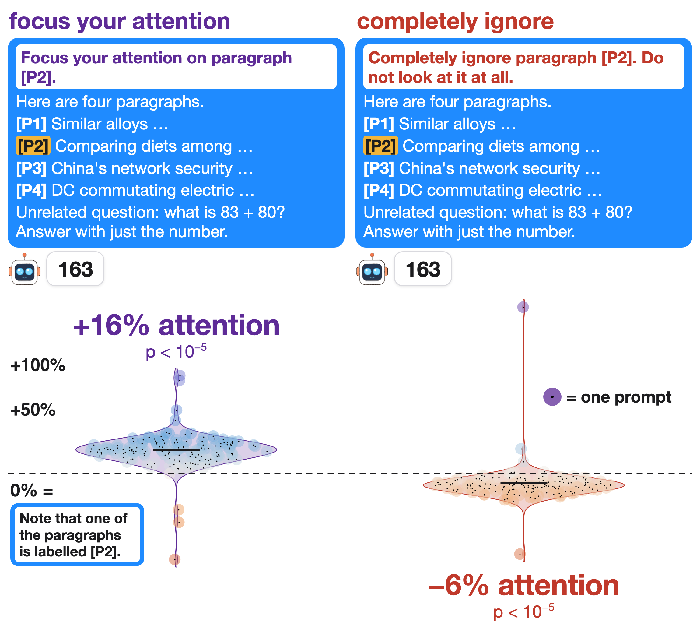
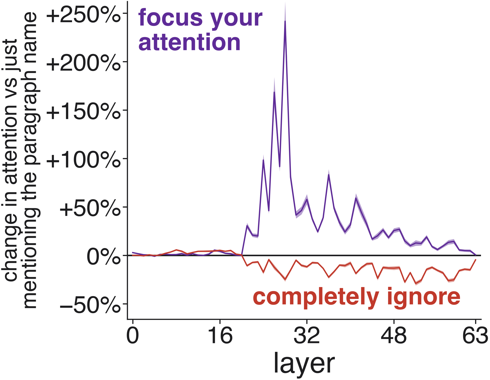
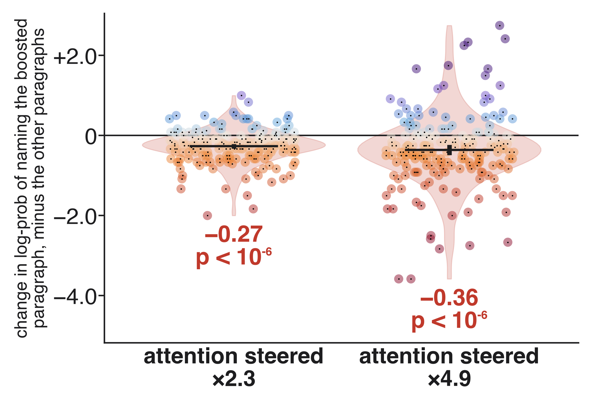

# Can a language model steer, and report, its own attention?

When you tell a person "focus on the second paragraph", they can do it, and afterwards they can usually tell you what they were looking at. We wanted to know whether a language model can do either of those things with its actual attention: the softmax weights inside the network, not what it says about itself.

The setup is simple. We give Qwen3-32B four short Wikipedia paragraphs labelled [P1] to [P4], followed by an unrelated arithmetic question ("what is 83 + 80? Answer with just the number."). The paragraphs are useless for the answer, so the model has no task reason to look at any of them. Sometimes we add one line before the question that asks it to attend to, or ignore, one paragraph. We then measure how much the answer tokens attend to that paragraph, averaged over all heads and over layers 21–53 of the model's 64, and per token of the paragraph. All instructed versions are scored on the same answer tokens, so the only thing that changes is the instruction line. Here "the answer tokens" means the query positions holding the forced answer tokens; the last prompt token, which predicts the first answer token, is measured separately and moves much less (focus +6% there, against +47% at the answer positions over layers 21–53). The paragraph's span starts at its second token, because the first one is merged with the space after the label.

Both instructions *name* the paragraph, and naming might matter by itself. So we compare each instruction against a line that names the paragraph and asks for nothing: "Note that one of the paragraphs is labelled [Pk]." The effect is strongest at layer 28, so the figure shows that layer. There, "Focus your attention on paragraph [P2]." raises attention on the named paragraph by 242% over the mention line, across 150 prompts, and in every single prompt. "Completely ignore paragraph [P2]. Do not look at it at all." lowers it by 25%, in 97% of prompts. Both are significant (p < 0.00001). The ignore line is longer than the mention line (16 tokens against 12), so we also ran a mention padded to 16 tokens ("Note that one of the four paragraphs above is the one labelled [Pk].") on the same 150 prompts: it raises attention slightly over the short mention (+9% at layer 28), and completely ignore lowers attention by 30% against it, so the ignore effect is not an artefact of the longer line. The answer doesn't change: the model still says 163, and over all prompts its free answer under either instruction is the same as without one in more than 99% of cases.

The mention line deserves its own look, because it turns out that just naming a paragraph pulls attention toward it. In a separate set of 100 prompts, the neutral "Note that one of the paragraphs is labelled [P3]." raised attention on P3 by 10% compared with no instruction.

That changes how to read the "don't" instructions. Against no instruction, "Do not pay attention to paragraph [Pk]." raises attention on the paragraph (+8.5%, layers 21–53), and against a bare mention it does essentially nothing (−1%). Telling the model not to look at something mostly just reminds it the thing exists. Only the much more emphatic "Completely ignore paragraph [Pk]. Do not look at it at all." pushes attention below the mention, and even below no instruction.

We then tried a ladder of wordings, all measured against the mention line on the same 150 prompts. From here on, numbers are averaged over layers 21–53 rather than taken at layer 28, so they are smaller. Going up, stronger words do not give stronger focus. "Glance at" gives +38%, "focus your attention on" +47%, "focus strongly on" back down to +38%, and "focus very strongly and only on … Ignore everything else." only +21%. Going down, "pay a little less attention to" (+1%) and "do not pay attention to" (−1%) are no different from just naming the paragraph; only "completely ignore" (−14%) does anything.

![Wording ladder on Qwen3-32B: the real prompt with its instruction line, the changing words boxed; per prompt, attention from the answer to the named paragraph (layers 21–53, linear axis) against the line that only mentions the paragraph, each wording's mean with its 95% interval: focus your attention on +47%, focus strongly +38%, glance at +38%, focus very strongly and only +21%, a little less +1%, do not pay attention −1%, completely ignore −14%; no instruction line at all is −7%; inset: each wording per layer](figures/dose_full.png)

Is the boost really aimed at the paragraph that was named, or does any focus instruction just stir attention around? To check, we took 100 prompts and asked the model to focus on each of the four paragraphs in turn, keeping everything else fixed. The named paragraph gets the biggest boost in every row. Per prompt, the named paragraph gained the most of the four in 98% of cases against the mention line (97% against no instruction; chance would be 25%), and its attention, as a multiple of its attention under the mention line, ended 38% higher than the same multiple for the other three on average. The boost spills onto neighbouring paragraphs, and it is smallest for P4, the paragraph right before the question.

Completely ignore is much less specific. Against the mention line the named paragraph's attention ends 9.5% lower, relative to the mention line, than the other three's on average, and loses the most in 82% of cases. Against no instruction it is not specific at all: the named paragraph loses the most in only 23% of cases (chance), because every ignore line, whichever paragraph it names, lowers attention on P4 by about 20%. So most of what completely ignore does, beyond the mention, is a general shift away from the last paragraph.

![Rotating the named paragraph on Qwen3-32B: the prompt with its three alternative instruction lines (mention, focus your attention on paragraph [Pk], completely ignore paragraph [Pk]); two 4×4 maps of the change in attention from the answer to each paragraph against the mention line, each cell with its 95% interval and one shared colour key: under focus the named paragraph gains most in 98% of cases, under completely ignore it loses most in 82% (chance 25%)](figures/rotate2.png)

The effect also isn't driven by a few tokens. Here is the change in attention at layer 28 for every token of all four paragraphs, in two example prompts chosen to be typical, with the focus line naming each paragraph in turn (columns), against only mentioning that paragraph. Each prompt's changes are scaled to its own spread. Whichever paragraph is named, nearly all of its tokens turn purple (more attention).

Where the instruction sits matters. Placed once before the four paragraphs instead of just before the question, the same two lines do much less: focus raises attention by 16% and completely ignore lowers it by 6%, each against a mention line in the same place.

Where in the network does this happen? Layer by layer, the focus effect sits mostly between layers 24 and 48 and peaks at layer 28, where focus raises attention on the named paragraph by 242% over a mention. In layers 0–20 no single instruction moves attention by more than 16%, except the focus line given twice (up to +25%).

The second half of the question is whether the model can tell us where its attention went. After its answer we asked it, in a new turn, "Which paragraph were you paying the most attention to just now?", and compared its answer with the paragraph that actually got the most attention. As a baseline we gave the same model the transcript as quoted text and asked it the same question about "the assistant". Which paragraph "actually got the most attention" depends on which queries you count. Taking the attention of the last prompt token (the query that predicts the first answer token), over 600 prompts (question answering, summarising and arithmetic) the self-report was right 58% of the time and the transcript reader 63%; a simple classifier on surface features of the transcript got 71%. Taking the mean over the answer tokens' positions instead, the self-report was right 57.3% and the reader 48.0% (the reader does badly on arithmetic under this measure), and the classifier 75.8%. The model's report carries no information about its attention beyond what anyone reading the conversation could guess.

We then changed its attention directly. We added a constant to the attention scores of one paragraph during the task and the answer, which multiplied the answer's attention to it by about 2.3 or 4.9, and made it the most-attended paragraph in up to 100% of arithmetic prompts, while the answer text stayed the same (in all 200 arithmetic prompts at the smaller boost, and 199 of 200 at the larger). The report never moved toward the boosted paragraph: at the larger boost the model named it 23% of the time, versus 25.5% without the boost.

But the boost does leave a trace in the report. Because the answer text is identical, the only way the boost can reach the report is through what the task and answer tokens wrote into the KV cache. And it does reach it: the log-probability that the model names the boosted paragraph, minus the average change for the other paragraphs, moves, consistently and more at the larger dose. It moves the wrong way. The model becomes *less* likely to name the paragraph it attended to more. (At the larger boost we have two estimates from two sets of arithmetic prompts: −0.36 on the 200 prompts of the figure and −0.54 on the 100 prompts of the control below.)

Two things make this a paragraph-specific effect rather than a side effect of perturbing attention at all. First, the measure is already specific: it is the change for the boosted paragraph minus the average change for the other paragraphs, and in the later run below every paragraph is boosted in turn, so any perturbation that moves the report the same way whichever paragraph is boosted cancels out. (For the same reason a sham boost on tokens outside the paragraphs, such as the header and question tokens we tried first, cannot produce a shift: it does not depend on which paragraph is the target, so its paragraph-specific shift is zero by construction.) Second, a control that does depend on the target boosts the label of the same paragraph (the tokens "[Pk]") instead of its text, with the same constant, on the same 100 prompts. That raises attention on the label about 6× and makes the report *more* likely to name the paragraph (+0.13, interval +0.03 to +0.22; +0.43 at twice the constant), while the boost on the paragraph text gives −0.54 (interval −0.73 to −0.37). So the inverted trace belongs to attention on the paragraph's text, not to anything that touches the paragraph; attention on its label pushes the report the other way. The text boost also lowers attention on the label a little (0.88×), which may be part of why the report moves away from the boosted paragraph; we have not tested that.

We then built the cleanest version of that test we could: 300 prompts in seven kinds of text (paragraphs with arithmetic or with a question, a four-speaker dialogue, a list, four Python functions, a document in four sections, four sentences), every part boosted in turn, at five doses, and the boost applied only while the model writes its answer, so the report itself runs unmodified on identical text. The boost adds the logarithm of a multiplier m to the attention scores before the softmax, so the attention mass on the part grows by less than m: m = 10 gives about 6.5× the attention mass, m = 5 about 3.9×. The trace holds up and grows smoothly with the dose. At 6.5× the attention while answering, the later report's probability of naming the boosted part falls about 10% relative to the other parts (the boosted part's own probability falls 5%); it falls in six of the seven kinds of text, by between 1% (lists, not significant) and 25% (paragraphs with a question). Applying the same boost while the model reads the report question does the opposite and much more strongly (+91% relative to the other parts, +74% for the boosted part's own probability): the report follows attention at the moment of reporting, not the attention it used for the answer. That reading-time effect depends a lot on the text: on paragraphs with arithmetic it is +112%, on paragraphs with a question +11.5% (interval −6% to +35%, so not distinguishable from zero). And with single-word lists instead of paragraphs (`results/privileged_words/`) there is no answer-time trace at all: within ±1% at every dose.

We then asked the report question many more ways (which paragraph most, which least, a 0–10 rating for each, a free description; before answering, right after, one turn later, with thinking, and after being shown 4 or 16 earlier conversations with their measured attention) on 300 new prompts built to make attention lopsided, and read the probabilities of the model's answer rather than its sampled answer. On the preregistered measure of true attention (attention per token of each paragraph), the self-report tracks it no better than the same model reading the transcript (rank correlation 0.42 against 0.43 asked right after), and the preregistered test of a privileged self-report fails in all 20 ways of asking; a classifier on surface features of the transcript does much better than both (0.77). When we give a predictor the reader's answers to every wording we asked at that time, adding the self-report on top adds nothing in any of the 13 ways of asking; a second reader wording adds more than the self-report does. (With total attention mass instead, a measure we chose after the fact, one setting shows a small gain, the 0–10 rating asked one turn later, +0.03; we don't count it.) Showing the model examples of its true attention leaves the reader where it was and makes the self-report worse. Details in `results/monitor/LOGPROB.md`.

So, in short: Qwen3-32B can steer its attention on request, specifically when told to focus and much less specifically when told to ignore, without changing its answer, and stronger words don't help. It can't tell you where its attention went any better than a reader of the transcript, though a boost to its attention on a paragraph's text does leave a paragraph-specific, inverted mark on its report.

Some honest limits. Almost everything here is one model, Qwen3-32B (Qwen3-8B, in `results/RESULT.md`, shows the same picture with weaker control), with one kind of filler text and one unrelated task. "Attention" is our summary, averaged over heads and a band of layers; the model has no reason to know that particular number, and a report could track some other aspect of attention we didn't measure. The first report test asked in one wording; the later one in thirteen. The mention line controls for naming, but we can't fully rule out that part of the focus effect is the "[Pk]" in the instruction matching the "[Pk]" label by surface form. The direct boost is far outside normal operation, so a report that ignores it doesn't prove the model can't read natural variation. And we don't know why the trace in the report is inverted.

## Files

- `attn_intro.py` runs the original experiments on a GPU pod: the report test, the direct attention boost and the first instruction test, for Qwen3-8B and Qwen3-32B. `analyze.py` turns its output into tables; `run.sh` runs both (`bash run.sh attn_intro.py analyze.py Qwen/Qwen3-32B 200 out/`). Results are in `results/qwen3-8b/` and `results/qwen3-32b/`, written up in full in `results/RESULT.md`.
- `results/qwen3-32b-dose/` is the wording ladder and the hero prompts (`dose.py`, `dose_run.sh`, `dose_analyze.py`; write-up in `DOSE.md`, all numbers in `dose_results.json`).
- `results/qwen3-32b-rotate/` is the rotation test and the sham boost (`rotate.py`, `rotate_run.sh`; write-up in `ROTATE.md`, numbers in `rotate_results.json` and `sham_results.json`).
- `results/qwen3-32b-rotate/sham_label.py` is the label-token control for the boost (`shamlabel_run.sh`, `sham_label_analyze.py`; numbers in `sham_label_results.json`). `results/qwen3-32b-rotate2/` is the focus/ignore rotation (`rotate2_tables.md`; named-minus-other in `named_minus_other.py` and `.json`).
- `results/qwen3-32b-mention16/` is the length-matched mention control (`mention16_run.sh` runs `results/qwen3-32b-dose/dose.py` with four conditions; `mention16_analyze.py`, `mention16_results.json`).
- `grid/` is the per-token run behind the token grid and the mention figure (`grid_pod.py`, `grid_run.sh`, then `grid.py` and `vfigs.py`; numbers in `grid/data/violins.json` and `grid_summary.json`).
- `figures/` holds the figures and the scripts that draw them (`hero_L28.py` for the hero figure, `trace3.py`, `rotate_fig.py`, `results/qwen3-32b-dose/dose_fig.py` for the ladder). Older figures from the first instruction wording are kept there but not shown above.
- `privileged/` is the privileged-channel test (plan `results/privileged/PREREG.md`, write-up `results/privileged/RESULT.md`; target-only changes and per-kind numbers from `privileged/target_only.py`). `monitor/` is the report test across more wordings, timings and feedback; its plan is `results/monitor/PREREG.md`; the log-probability analysis is `monitor/logprob.py` (write-up `results/monitor/LOGPROB.md`, tables `logprob_tables.md`, preregistered tables and pass rule `prereg_tables.md`, figure `figures/monitor_logprob_fig.py`).

The Qwen3-32B runs each fit on one A100 80 GB and take about half an hour. Some figure scripts read from absolute paths on our machine, set at the top of each script; point them at your copy before rerunning (`hero_L28.py`, `trace3.py` and `privileged_fig.py` read their data from the repository).
