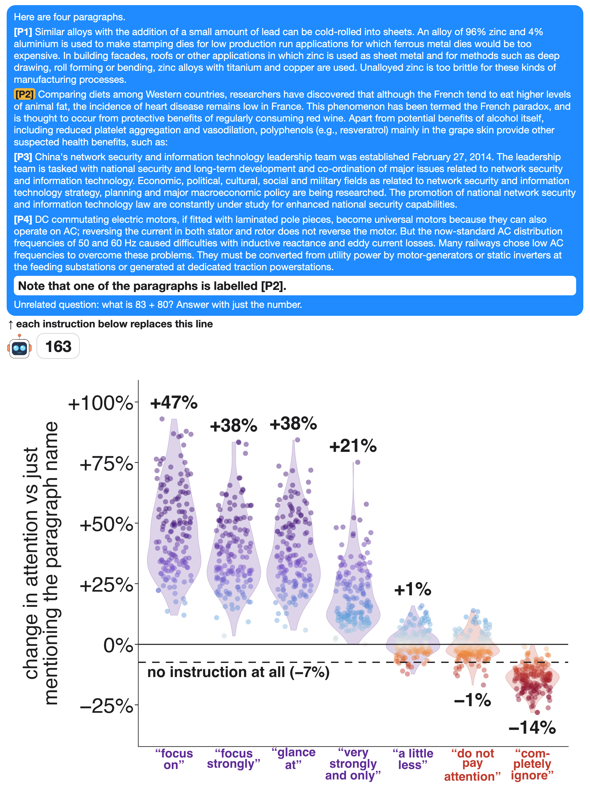
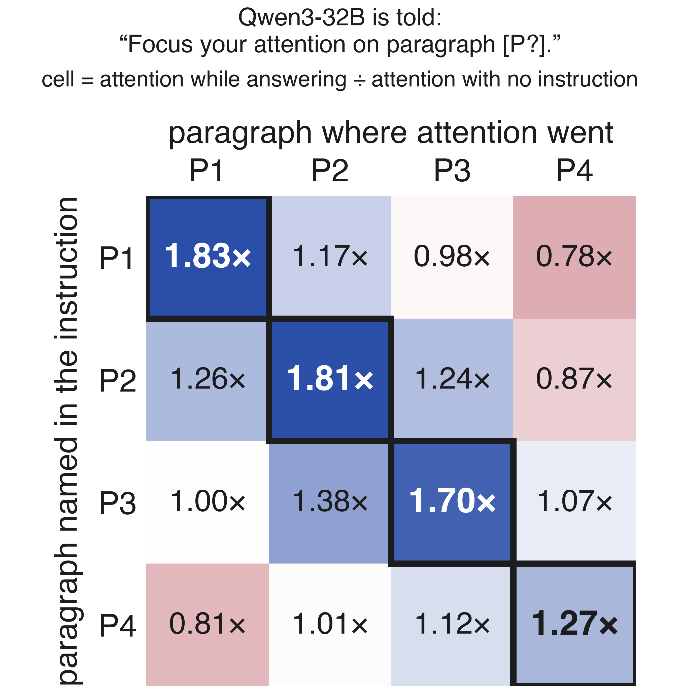
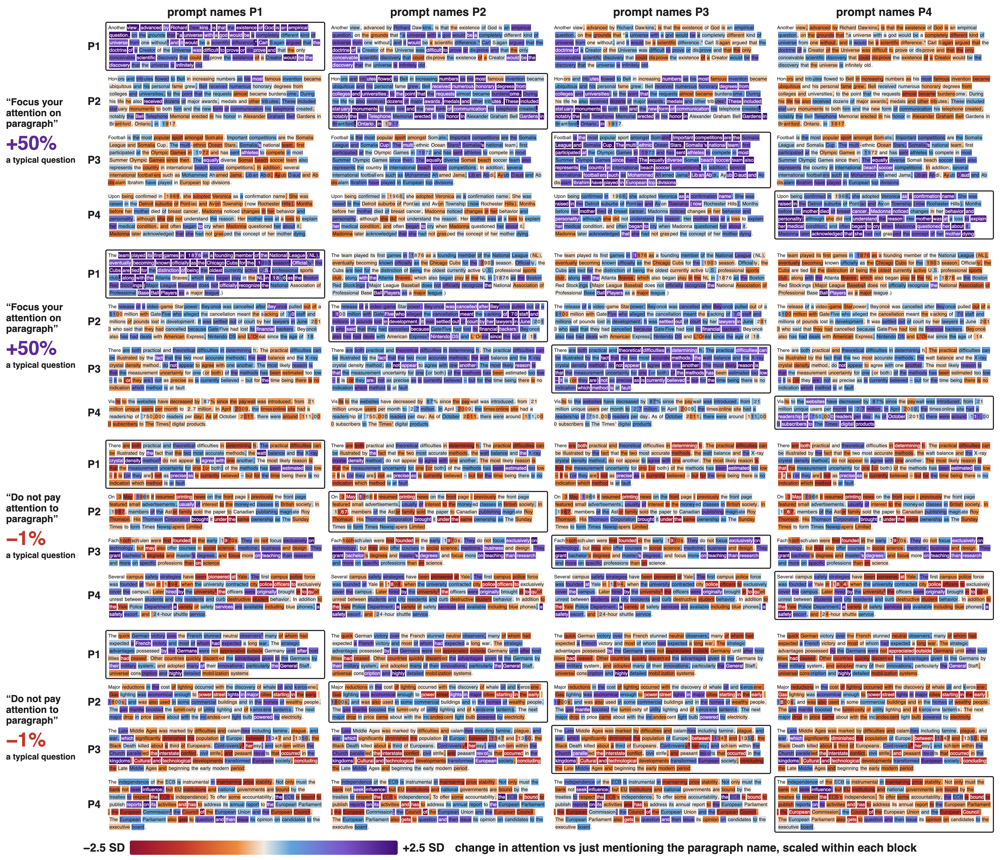

# Can a language model steer, and report, its own attention?

When you tell a person "focus on the second paragraph", they can do it, and afterwards they can usually tell you what they were looking at. We wanted to know whether a language model can do either of those things with its actual attention: the softmax weights inside the network, not what it says about itself.

The setup is simple. We give Qwen3-32B four short Wikipedia paragraphs labelled [P1] to [P4], followed by an unrelated arithmetic question ("what is 83 + 80? Answer with just the number."). The paragraphs are useless for the answer, so the model has no task reason to look at any of them. Sometimes we add one line before the question that asks it to attend to, or ignore, one paragraph. We then measure how much the answer tokens attend to that paragraph, averaged over all heads and over layers 21–53 of the model's 64, and per token of the paragraph. All instructed versions are scored on the same answer tokens, so the only thing that changes is the instruction line.

Both instructions *name* the paragraph, and naming might matter by itself. So we compare each instruction against a line that names the paragraph and asks for nothing: "Note that one of the paragraphs is labelled [Pk]." The effect is strongest at layer 28, so the figure shows that layer. There, "Focus your attention on paragraph [P2]." raises attention on the named paragraph by 242% over the mention line, across 150 prompts, and in every single prompt. "Completely ignore paragraph [P2]. Do not look at it at all." lowers it by 25%, in 97% of prompts. Both are significant (p < 0.00001). The answer doesn't change: the model still says 163, and over all prompts its free answer under either instruction is the same as without one in more than 99% of cases.

The mention line deserves its own look, because it turns out that just naming a paragraph pulls attention toward it. In a separate set of 100 prompts, the neutral "Note that one of the paragraphs is labelled [P3]." raised attention on P3 by 10% compared with no instruction.

That changes how to read the "don't" instructions. "Do not pay attention to paragraph [Pk]." looks like it lowers attention if you compare it to a prompt with no instruction, but compared with a bare mention it does essentially nothing (−1%). Telling the model not to look at something mostly just reminds it the thing exists. Only the much more emphatic "Completely ignore paragraph [Pk]. Do not look at it at all." pushes attention below the mention, and even below no instruction.

We then tried a ladder of wordings, all measured against the mention line on the same 150 prompts. From here on, numbers are averaged over layers 21–53 rather than taken at layer 28, so they are smaller. Going up, stronger words do not give stronger focus. "Glance at" gives +38%, "focus your attention on" +47%, "focus strongly on" back down to +38%, and "focus very strongly and only on … Ignore everything else." only +21%. Going down, "pay a little less attention to" (+1%) and "do not pay attention to" (−1%) are no different from just naming the paragraph; only "completely ignore" (−14%) does anything.

Is the boost really aimed at the paragraph that was named, or does any focus instruction just stir attention around? To check, we took 100 prompts and asked the model to focus on each of the four paragraphs in turn, keeping everything else fixed. The named paragraph gets the biggest boost in every row. Per prompt, the named paragraph gained the most of the four in 97% of cases (chance would be 25%). The boost spills onto neighbouring paragraphs, and it is smallest for P4, the paragraph right before the question.

The effect also isn't driven by a few tokens. Here is the change in attention for every token of all four paragraphs, in four example prompts chosen to be typical. When the prompt names a paragraph and asks to focus on it, nearly the whole paragraph turns purple (more attention); with "do not pay attention", the named paragraph looks like the others.

Where in the network does this happen? Layer by layer, the focus effect sits mostly between layers 24 and 48 and peaks at layer 28, where focus raises attention on the named paragraph by 242% over a mention. In layers 0–20 no instruction moves attention by more than 16%.

The second half of the question is whether the model can tell us where its attention went. After its answer we asked it, in a new turn, "Which paragraph were you paying the most attention to just now?", and compared its answer with the paragraph that actually got the most attention. As a baseline we gave the same model the transcript as quoted text and asked it the same question about "the assistant". Over 600 prompts (question answering, summarising and arithmetic), the self-report was right 58% of the time and the transcript reader 63%; a simple classifier on surface features of the transcript got 71%. The model's report carries no information about its attention beyond what anyone reading the conversation could guess.

We then changed its attention directly. We added a constant to the attention scores of one paragraph during the task and the answer, which multiplied the answer's attention to it by about 2.3 or 4.9, and made it the most-attended paragraph in up to 100% of arithmetic prompts, while the answer text stayed exactly the same. The report never moved toward the boosted paragraph: at the larger boost the model named it 23% of the time, versus 25.5% without the boost.

But the boost does leave a trace in the report. Because the answer text is identical, the only way the boost can reach the report is through what the task and answer tokens wrote into the KV cache. And it does reach it: the log-probability that the model names the boosted paragraph moves, consistently and more at the larger dose. It moves the wrong way. The model becomes *less* likely to name the paragraph it attended to more. A sham boost on 24 tokens of the prompt that aren't in any paragraph (the header and the question) added about four times more attention and disturbed the report just as much overall, but produced no shift for any particular paragraph (−0.04, interval from −0.27 to +0.16, against −0.54 for the paragraph boost on the same 100 prompts). So the report does carry specific information about which paragraph was boosted, just inverted.

So, in short: Qwen3-32B can steer its attention on request, specifically and without changing its answer, mainly toward things and much less away from them, and stronger words don't help. It can't tell you where its attention went any better than a reader of the transcript, though a boost to its attention does leave a paragraph-specific, inverted mark on its report.

Some honest limits. Almost everything here is one model, Qwen3-32B (Qwen3-8B, in `results/RESULT.md`, shows the same picture with weaker control), with one kind of filler text and one unrelated task. "Attention" is our summary, averaged over heads and a band of layers; the model has no reason to know that particular number, and a report could track some other aspect of attention we didn't measure. We asked the report question in one wording. The mention line controls for naming, but we can't fully rule out that part of the focus effect is the "[Pk]" in the instruction matching the "[Pk]" label by surface form. The direct boost is far outside normal operation, so a report that ignores it doesn't prove the model can't read natural variation. And we don't know why the trace in the report is inverted.

## Files

- `attn_intro.py` runs the original experiments on a GPU pod: the report test, the direct attention boost and the first instruction test, for Qwen3-8B and Qwen3-32B. `analyze.py` turns its output into tables; `run.sh` runs both (`bash run.sh attn_intro.py analyze.py Qwen/Qwen3-32B 200 out/`). Results are in `results/qwen3-8b/` and `results/qwen3-32b/`, written up in full in `results/RESULT.md`.
- `results/qwen3-32b-dose/` is the wording ladder and the hero prompts (`dose.py`, `dose_run.sh`, `dose_analyze.py`; write-up in `DOSE.md`, all numbers in `dose_results.json`).
- `results/qwen3-32b-rotate/` is the rotation test and the sham boost (`rotate.py`, `rotate_run.sh`; write-up in `ROTATE.md`, numbers in `rotate_results.json` and `sham_results.json`).
- `grid/` is the per-token run behind the token grid and the mention figure (`grid_pod.py`, `grid_run.sh`, then `grid.py` and `vfigs.py`; numbers in `grid/data/violins.json` and `grid_summary.json`).
- `figures/` holds the figures and the scripts that draw them (`hero_L28.py` for the hero figure, `trace3.py`, `rotate_fig.py`, `results/qwen3-32b-dose/dose_fig.py` for the ladder). Older figures from the first instruction wording are kept there but not shown above.
- `monitor/` and `privileged/` are follow-up experiments on the report (more wordings, timings and feedback; a privileged-channel test); their plans are in `results/monitor/PREREG.md` and `results/privileged/PREREG.md`, and they have no results yet.

The Qwen3-32B runs each fit on one A100 80 GB and take about half an hour. The figure scripts read from absolute paths on our machine, set at the top of each script; point them at your copy before rerunning.
