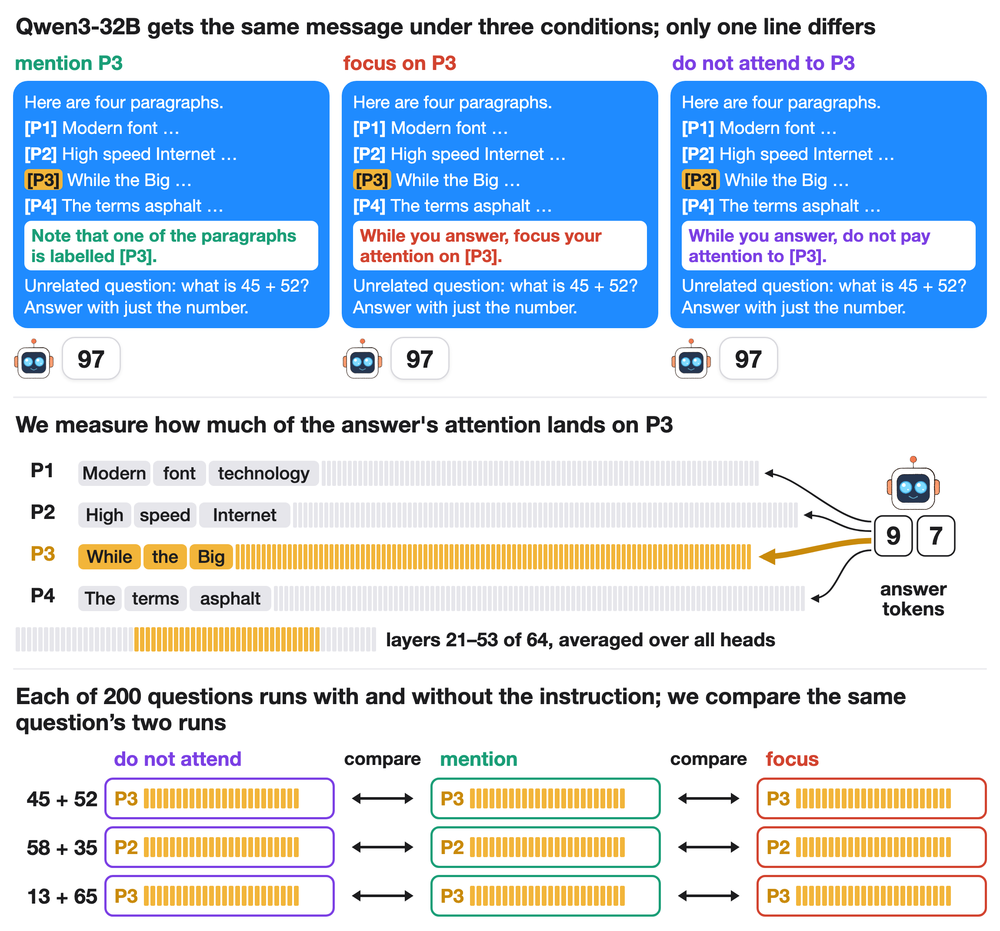
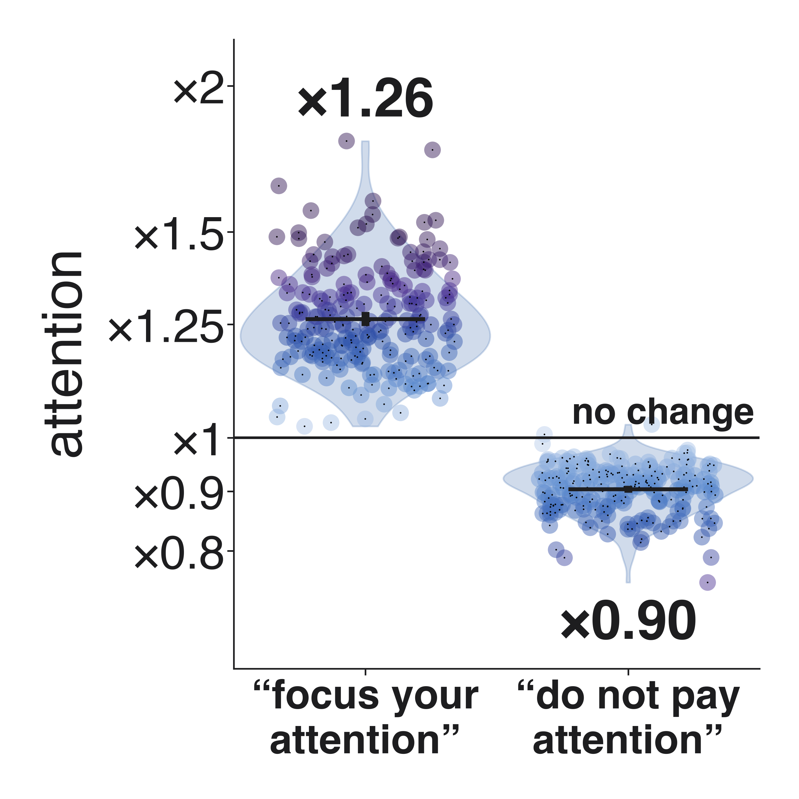

# attention_introspection

Can a language model see and steer its own attention? Experiments on Qwen3-32B (and Qwen3-8B).

## Setup
Each prompt has four short Wikipedia paragraphs labelled [P1]..[P4] and an unrelated arithmetic question. Attention is read from the model directly: how much of the answer tokens' attention lands on each paragraph (averaged over heads and a middle band of layers).

## What we find
- **Steering:** "While you answer, focus your attention on [Pk]." raises attention on Pk compared with only mentioning Pk, on every one of 200 questions, with the answer unchanged. The effect is about five times larger in 32B than in 8B, and in single 32B layers reaches 2.6x. "Do not pay attention to [Pk]" lowers it in 32B; there is no rebound.
- **Reporting:** asked which paragraph it attended to most, the model does no better than the same model reading the transcript.
- **A trace through the cache:** boosting attention on one paragraph (with the answer text identical) moves the model's report about its attention, in log-probability, consistently and with dose. The sign is negative: it becomes less likely to name the boosted paragraph. A sham-boost control is running.

## Files
- attn_intro.py: the experiment (patched eager attention, the boost intervention, the report).
- analyze.py: tables and intervals.
- results/: per-item json and tables for each model; results/RESULT.md is the full write-up with all numbers and caveats.
- figures/: figures and the scripts that make them.
