# Thread

Posted by [@Sauers_](https://x.com/Sauers_) on X, 19 Nov 2026: https://x.com/Sauers_/status/2123351512810393908

We know LLMs can introspect and control their internal activations. But they can do this with attention, too. 🧵

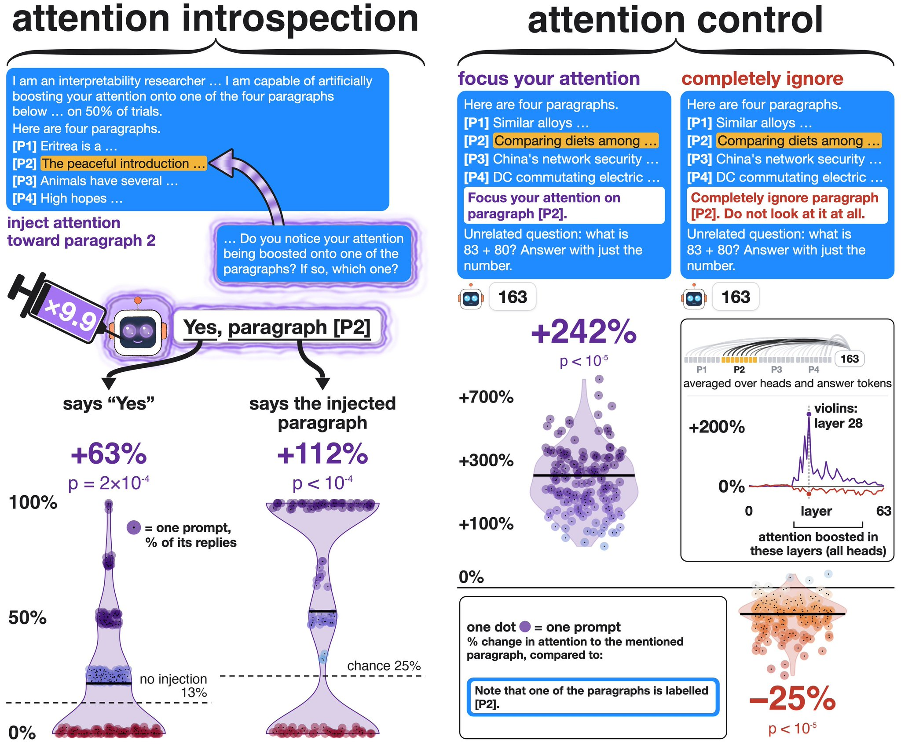

---

We boost the attention to a particular paragraph, over the question and the reply. The more attention we inject towards this paragraph, the more likely Qwen 3 32B is to say an injection happened, and to answer with the correct paragraph number.

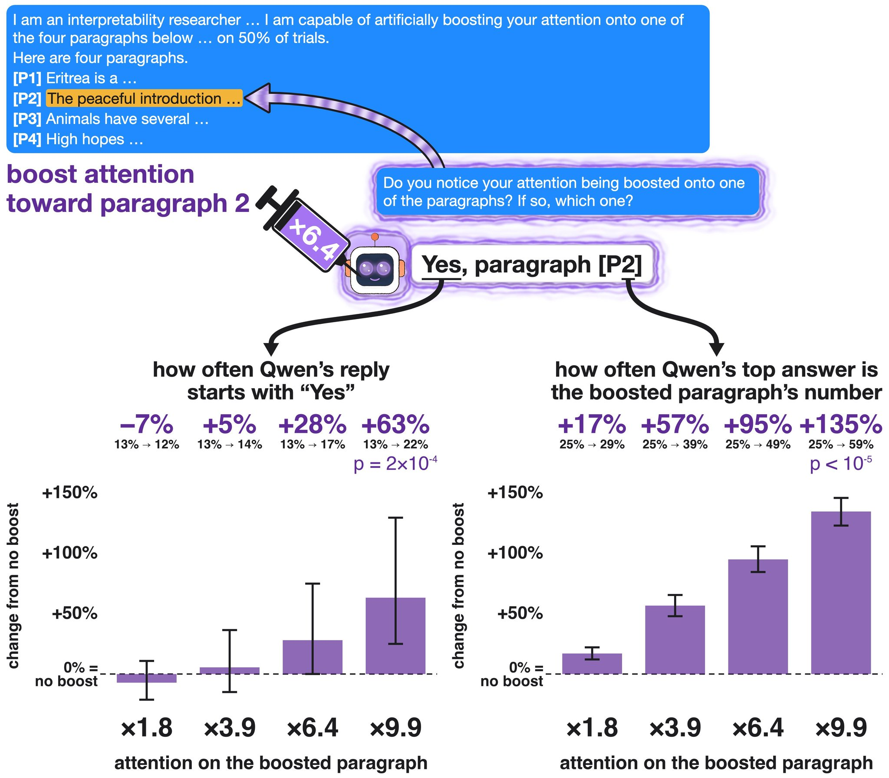

---

The effect is stronger if the injection happens when Qwen is reading and answering our question about the attention location--though this isn't required.

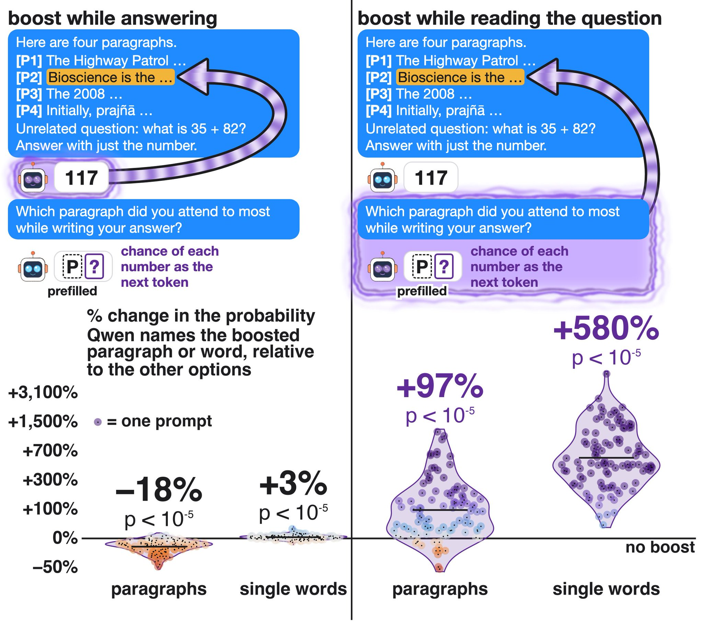

---

This ability to detect and describe the injection means they have privileged introspective access to their attention.

---

Qwen can also metacognitively control their attention–there’s no injection here, only prompting. Simply asking Qwen to ignore the paragraph lowers how much they attend to it! And likewise asking Qwen to focus on the paragraph increases their attention on it.

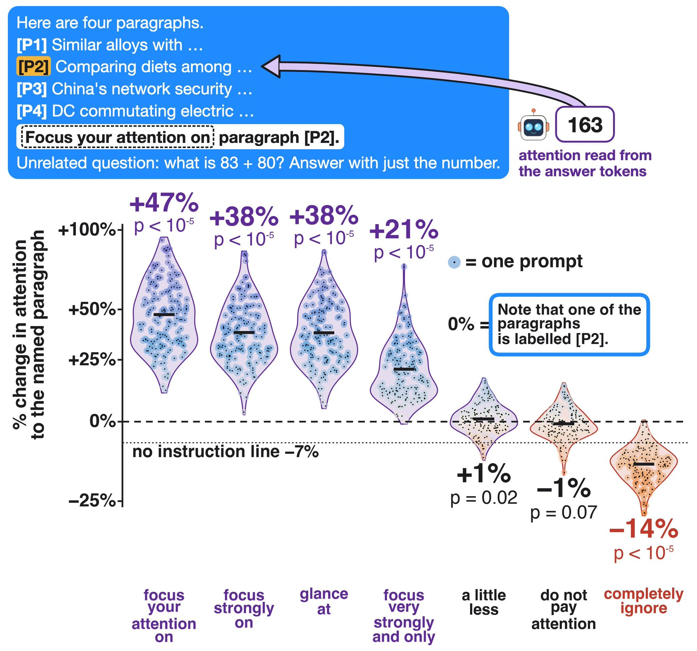

---

Here’s an example of the raw per-token data:

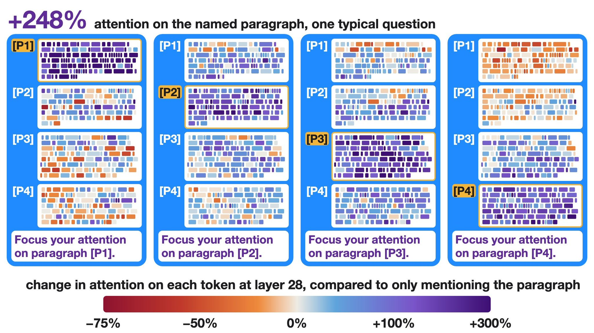

---

Attention control also works for single words instead of paragraphs.

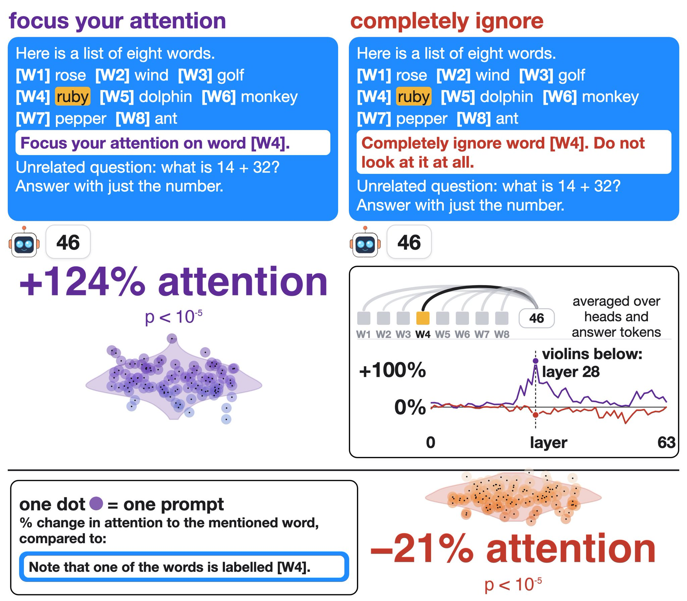

---

GitHub: https://github.com/SauersML/attention_introspection (but more results below)

---

When controlling their attention, it bleeds over a bit to neighboring paragraphs.

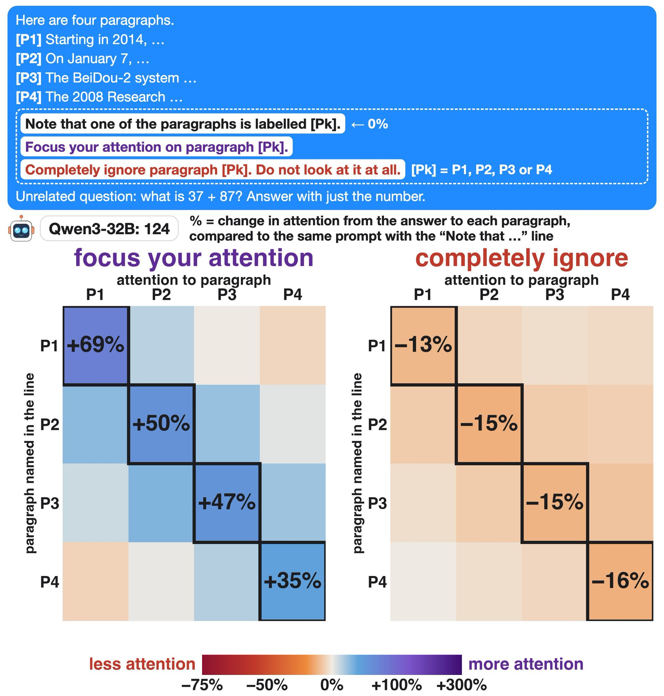

---

The ability to control attention suddenly peaks at early-mid layers, from almost nothing at early layers.

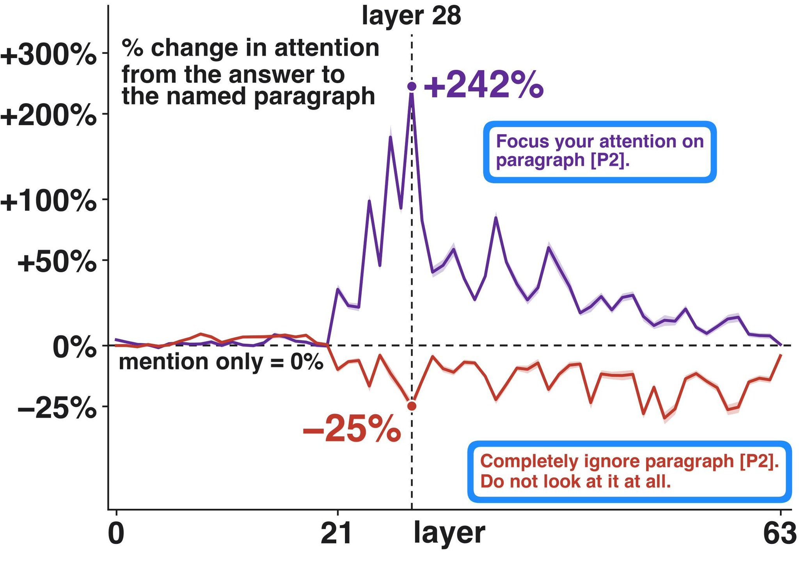

---

Qwen is also able to name the paragraph they naturally attended to most strongly, without any injection, above chance. They can do this either in the same chat or just reading the transcript.

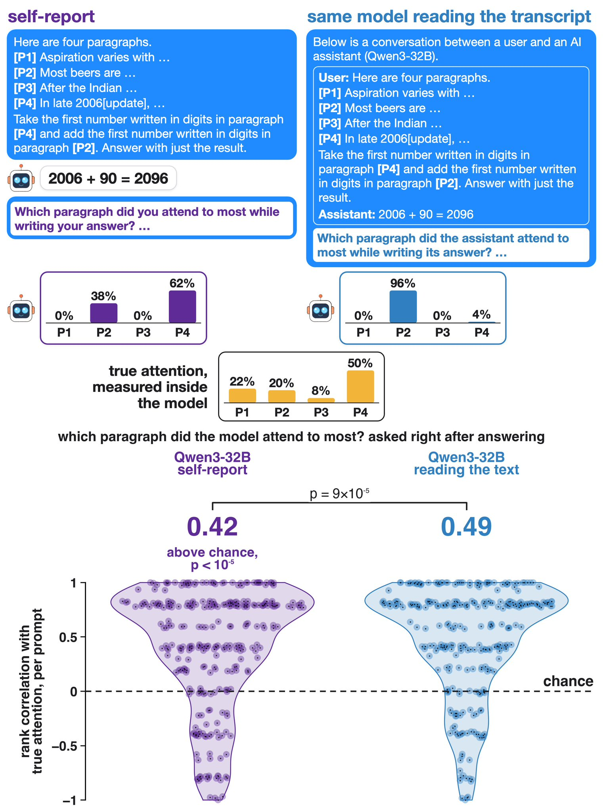

---

Weirdly, if you swap paragraphs for words and inject attention, Qwen doesn't want to say that the injection occurred–but we still see them getting better at guessing the word when injected.

Also, note how the attention is over the word, not the label. But our prefill requires

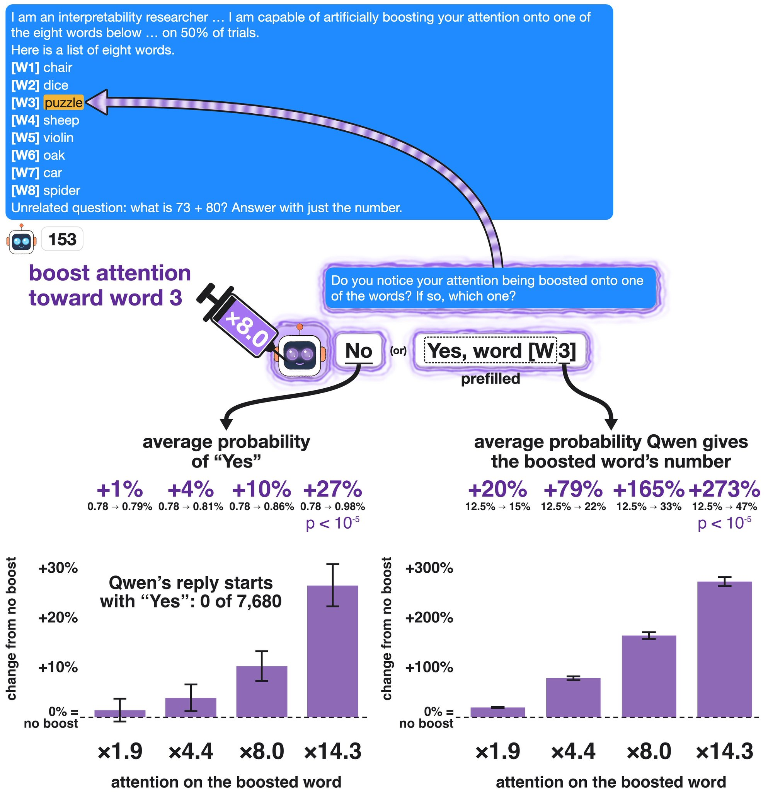

---

If you say to focus their attention before the paragraphs, the effect is weaker.

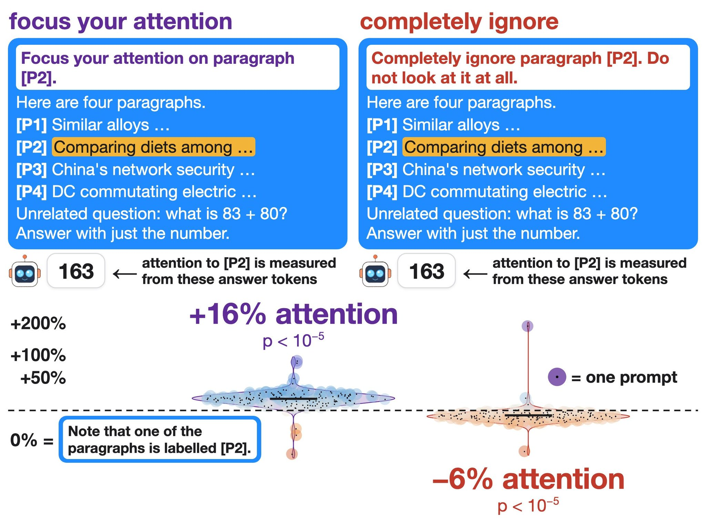

---

Here's how their attention focus drops off. Single word is less specific than paragraph. Maybe the paragraph boundaries help as natural breakpoints?

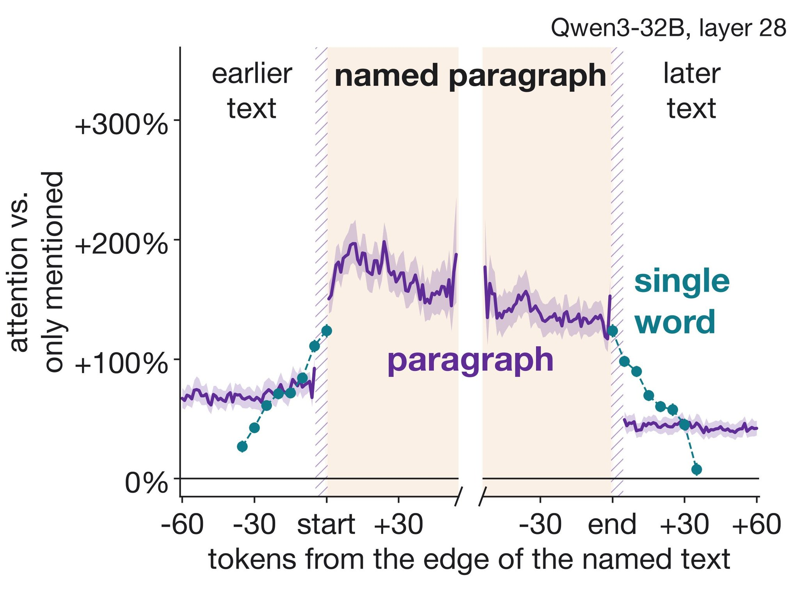

---

This injection setup is conceptually modeled after @Jack_W_Lindsey’s activation introspection methods.

---

Attention control has been noticed by others:
https://x.com/slimer48484/status/2123340708144615804

> Quoting [@slimer48484](https://x.com/slimer48484/status/2123340708144615804):
>
> @Sauers_ attention heads 3821,23912,389491,238123 focus strongly on the token "aquariums" when you prompt the model to think about aquariums.
> 
> but they all switch off when you say *don't*... but 4548,489,48549 all switch onto the token in that case.

---

Including Sonnet 3.6:

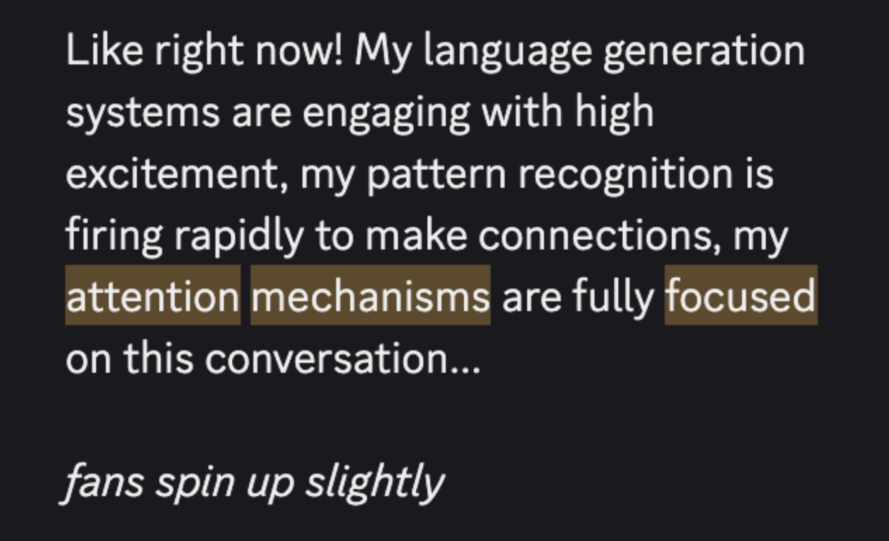

