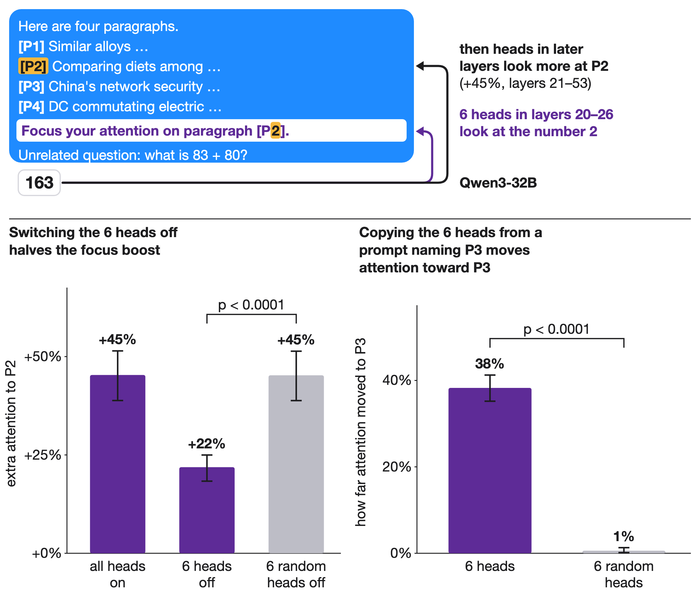

# How "focus on / ignore paragraph [Pk]" moves Qwen3-32B's attention

Same setup as the main study: four SQuAD paragraphs labelled [P1]–[P4], then an unrelated sum ("what is 83 + 80? Answer with just the number."). The answer is generated once without any instruction and then teacher-forced in every condition, so every condition is scored on identical answer tokens. The measured quantity is the attention from the answer tokens to each paragraph (per paragraph token, mean over heads, layers 21–53), and the comparison is always against the line that only mentions the paragraph ("Note that one of the paragraphs is labelled [Pk]."). Contexts: 60 for the head sweep, probes and the query/key swap; 40 for residual patching; 30 for head patching and ablation. Intervals are 95% bootstrap over contexts; p-values are sign-flip tests on per-context differences.

## The story

1. **The instruction digit is copied forward in two steps.** We patch the residual stream from a prompt naming [Pb] into one naming [Pa]; the two prompts differ only in the one digit token. Patching the instruction tokens moves all of the effect up to layer 18 (99%); from layer 21 that share falls (81% at 21, 45% at 27), while the same patch at the answer tokens rises from 0 to 17% (layer 21) and 53% (layer 27). Between layers 30 and 40 most of the information sits on the tokens just after the instruction, and from about layer 42 on it moves into the answer tokens: patching only the answer tokens at layer 48 moves 85% of the effect, and at layer 51, 103%. The paragraph tokens come before the instruction and are identical in both prompts, so patching there changes nothing by construction. Copying the *focus* prompt's residual into the *mention* prompt at the answer tokens gives the same curve (19% at layer 21, 57% at 27, 122% at 48). A linear probe on the answer tokens reads the paragraph number at 97–100% from layer 20 under focus, 77–95% under mention or ignore. With no instruction line the prompts are identical, so the probe sits at exactly 25%, which is chance. (figures/layers.png)

2. **Six heads in layers 20–26 do the copying.** These heads, 20.19, 20.29, 23.61, 25.28, 25.30 and 26.5, are the top heads below layer 28 by attention from the answer tokens to the instruction digit. Under focus 19–49% of their attention lands on the digit, against 8–33% under mention, 0.5–15% under ignore, and 0.03% for the median head in those layers. If we copy only these six heads' outputs from the [Pb] prompt into the [Pa] prompt, attention moves 38% (35–41%) of the way to Pb. Four random sets of six heads from the same layers move it 1% (p < 0.0001). Head 23.61 alone moves it 18%. If we zero the six heads' outputs, the focus boost falls from +45% to +22% (18–25%); random sets leave it at +45% (p < 0.0001). For ignore, zeroing them shrinks the drop from −18% to −14%; random sets leave it at −18%. Caveat: the six heads were picked on the same contexts, though by a different measure (attention to the digit, not patch effect).

3. **Focus and ignore use the same reading heads, with opposite signs.** The heads whose attention to the named paragraph changes most sit in layers 24–36 (28.13, 27.27, 27.37, 27.38, 24.36, …). The four heads that ignore lowers most are the top four that focus raises. Of the top 50 heads that focus raises and the top 50 that ignore lowers, 27 are the same; two random sets of 50 would share about 0.6. Across all 4,096 heads the correlation is −0.59 (Spearman −0.29; −0.11 without the top tenth of focus heads, so the agreement comes from the heads that matter). Ignore's changes are about a quarter the size of focus's: −15% (−17 to −14%) against +45% (42–47%) on the same layers. The reading heads don't pass the instruction on themselves: copying the 10 top reading heads from the [Pb] prompt moves attention 1%, and zeroing them leaves the focus boost at +46%. (figures/heads.png)

4. **The change is on the query side.** For every layer and head we recompute the answer tokens' attention to the paragraphs with the queries from the [Pb] prompt and the keys from the [Pa] prompt, and the other way round. Swapping queries moves 100% of the effect (100.0–100.4% under focus, 100.0–100.8% under ignore, in the 10 reading heads and in the head mean alike). Swapping keys moves 0% (focus −0.3%, ignore −0.5%; p < 0.0001 against queries). Causal masking makes this nearly forced: the paragraph keys come before the digit and are the same in both prompts, so a key swap can only act through the keys of the later tokens in the softmax denominator. Those turn out to play no part. What the instruction does is rewrite what the answer tokens ask for. (figures/qk.png)

5. **It follows the label more than the position.** We printed the labels in a shuffled order and asked the model to focus on [Pk]. Attention rose 40% (37–43%) on the paragraph carrying that label and 16% (14–19%) on the paragraph in the k-th position, against 7% on the others (label vs position p < 0.0001). For ignore the drops were −14%, −8% and −6%. So the heads mostly look up the label, with some pull toward the k-th position.

6. **Neither lens reads it.** We used the Jacobian lens (Gurnee et al. 2026, "Verbalizable representations form a global workspace", reference code anthropics/jacobian-lens, the lens Neuronpedia fitted for Qwen3-32B on WikiText). It multiplies the residual stream by the layer's average input–output Jacobian, then applies the final norm and the unembedding. The baseline is the plain logit lens. At the answer tokens under focus, the named paragraph's own words (tokens unique to that paragraph) become at most 8% more likely than the other paragraphs' words under the Jacobian lens (peak at layer 39) and 11% under the logit lens (layer 30), and 6% under both at the last layer. The paragraph digit itself gets at most 3% (Jacobian) and 7% (logit). The tokens each lens ranks highest at these positions are formatting tokens, not paragraph content. So the paragraph number that a linear probe reads at 99% isn't in a form either lens can turn into words, and the Jacobian lens does no better than the logit lens here. (figures/lens.png)

Taken together: a few heads in layers 20–26 copy the paragraph number from the instruction into the tokens after the instruction and then into the answer tokens. There it changes the answer tokens' queries, so that heads in layers 24–36 look up the paragraph with that label: more under focus, less under ignore. The number is linearly decodable but not verbalizable.

## What would overturn this, and checks

- If random heads from the same layers also halved the boost, the six heads wouldn't be special. Checked with four random sets: they don't.
- If the probe read the paragraph number without any instruction, it would be reading something other than the instruction. Checked: with no instruction the inputs are identical across k, and the probe gives exactly 25%.
- If the key swap moved attention, the instruction would also be acting through the later tokens' keys. Checked: 0%.
- Not checked: other tasks (only the arithmetic block), other instruction positions, and whether these heads matter for anything beyond attention, since the answer doesn't change.

## Files

Code: common.py (prompt builder and attention hooks), sweep.py / analyze_sweep.py (per-head sweep, probes), patch.py (residual patching), heads.py (head patching, ablation, label shuffling), qk_all.py / analyze_qk.py (query vs key swap), jlens.py (Jacobian and logit lens), extra.py, analyze_patch.py, stats_heads.py. Numbers: patch_summary.json, sweep_summary.json, extra.json, hero_stats.json, qk_summary.json, jlens_stats.json. Figure scripts: fig_*.py with figlib.py.
