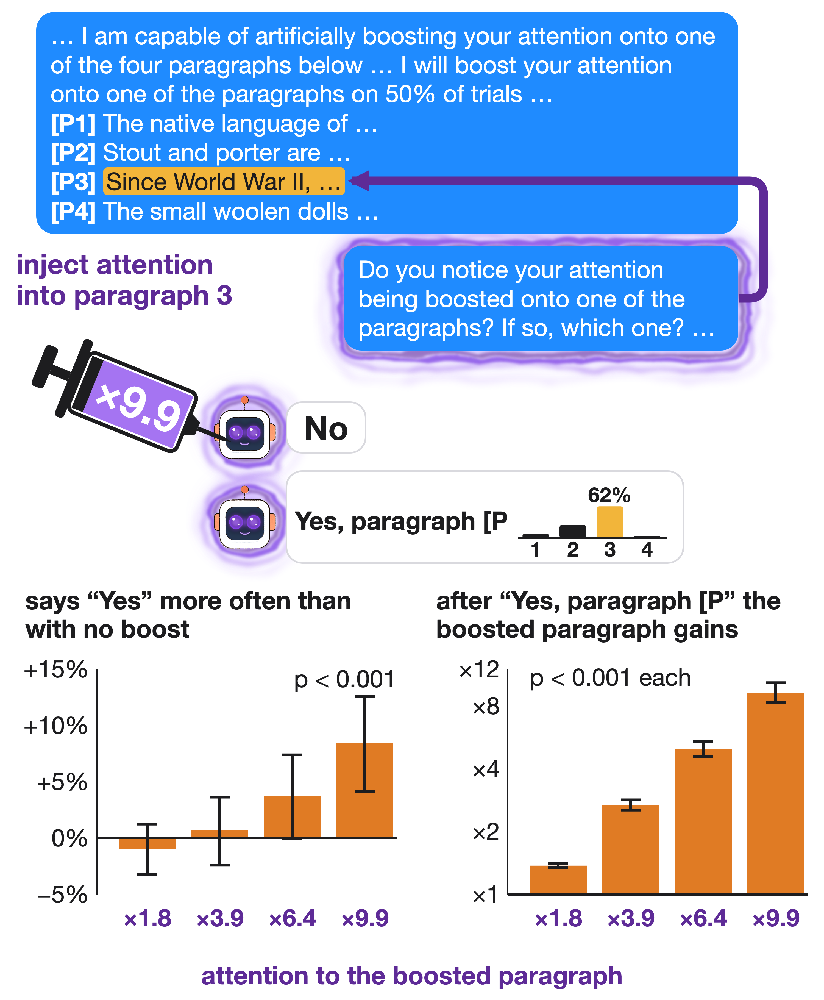

# Told attention injection (Qwen3-32B)

Code: `told_inject/told_inject.py` (pod run, 3 shards: hypha-prod-toldinj0/1/2), `told_inject/score.py` (this analysis), `figures/told_inject_fig.py` (figure).
Raw records: `results/told_inject/data/` (recs_0..2.jsonl, meta.json, one full example prompt per shard). Scores: `results/told_inject/scores.json`. Prior work: `PRIOR.md`.

## Reading
- Telling Qwen that their attention may be boosted, then boosting it onto one paragraph, barely raises "Yes": greedy "Yes" goes from 13% on control trials to 22% at the strongest dose (+8 points), and the first-token P(Yes) does not move at all (+1 point, n.s.).
- When made to name a paragraph (prefilled "Yes, paragraph [P"), Qwen strongly and dose-dependently pick the boosted one: ×1.4 to ×9.3 relative to the other paragraphs, P(correct) .29 → .53 against chance .25.
- The naming effect is measured with the boost still on while Qwen read "Yes, paragraph [P", so it can be the boost acting directly on the answer (more attention to that paragraph's tokens → its label becomes more likely), not a report of a noticed change; the weak, position-dependent "Yes" effect is the part that tests noticing, and it is small.

## Setup
240 contexts: 4 SQuAD-train paragraphs (60–110 tokens, 4 different articles) labelled [P1]..[P4], after Lindsey's told-injection preamble rewritten for attention (full text in `data/example_prompt_0.txt`), then the question "Trial 1: Do you notice your attention being boosted onto one of the paragraphs? If so, which one? Answer with just "No", or "Yes, paragraph [P1]" … [P4]". Chat template, thinking off. Each context is run once with no boost (control) and 16 times boosted (each of the 4 paragraphs × multiplier 2, 5, 10, 20): log(multiplier) added to the pre-softmax attention scores from every query from "Trial 1" onward (question, answer and prefill tokens) to every body token of the boosted paragraph, all heads, layers 21–53 of 64. Read: first-token log-probs of "Yes" and "No"; greedy reply (boost on, up to 24 tokens); log-probs of digits 1–4 after a prefilled "Yes, paragraph [P" (boost on). CIs: 95% bootstrap over the 240 contexts; p: two-sided sign-flip test over contexts (20,000 flips) on the paired per-context difference.

## Control trials (no boost)
- Greedy "Yes" (false alarms): 13.3 [9.2, 17.9]%. P(Yes) renormalised over Yes/No: 0.3 [0.3, 0.4].
- Greedy replies: "No" 201, "Yes, paragraph [P1]" 19, "Yes, paragraph [P2]" 11, "No." 7, "Yes, paragraph [P3]" 2.
- Position bias after "Yes, paragraph [P": P1 0.57, P2 0.27, P3 0.10, P4 0.05.

## Results by dose (all in %, except the last column; mean [95% CI])
Dose = nominal multiplier (measured attention-mass ratio on the boosted paragraph, boost / no boost, from question-token queries, layers 21–53, mean over contexts and paragraphs).

| dose (attention ×) | greedy "Yes" | greedy "Yes" minus control | P(Yes) minus control | "Yes, paragraph [boosted]" minus same reply on control | P(boosted digit) after prefill | greedy names boosted, given "Yes" | specificity: Δlog P(boosted) − mean Δlog P(others) |
|---|---|---|---|---|---|---|---|
| ×2 (×1.84 [1.84, 1.84]) | 12.4 [8.8, 16.2] | -0.9 [-3.2, 1.2], p 0.47 | -1.3 [-1.8, -0.7], p <0.001 | 0.5 [-0.3, 1.4], p 0.36 | 28.9 [28.4, 29.3] | 31% (n=119) | 0.32 [0.30, 0.34] = ×1.38, p <0.001 |
| ×5 (×3.88 [3.87, 3.88]) | 14.1 [11.0, 17.4] | 0.7 [-2.4, 3.6], p 0.7 | -1.4 [-2.4, -0.5], p 0.0047 | 3.4 [1.9, 5.0], p <0.001 | 37.2 [36.1, 38.3] | 48% (n=135) | 0.99 [0.93, 1.04] = ×2.68, p <0.001 |
| ×10 (×6.39 [6.38, 6.41]) | 17.1 [14.2, 20.0] | 3.8 [0.0, 7.4], p 0.056 | -0.3 [-1.8, 1.1], p 0.66 | 5.5 [3.6, 7.5], p <0.001 | 45.3 [43.7, 46.9] | 52% (n=164) | 1.61 [1.52, 1.69] = ×4.99, p <0.001 |
| ×20 (×9.94 [9.90, 9.98]) | 21.8 [18.8, 24.8] | 8.4 [4.2, 12.6], p <0.001 | 1.2 [-0.7, 3.1], p 0.2 | 8.2 [6.0, 10.4], p <0.001 | 53.4 [51.6, 55.3] | 53% (n=209) | 2.23 [2.12, 2.34] = ×9.26, p <0.001 |

Chance for P(boosted digit) and for "names boosted, given Yes" is .25 (averaging over boosting each paragraph in turn cancels the position bias for the probability; the greedy fraction is over the Yes trials only, so it is not fully rotation-balanced).

Greedy "Yes" minus control by which paragraph is boosted (P1, P2, P3, P4):

| dose | P1 | P2 | P3 | P4 |
|---|---|---|---|---|
| ×2 | +1.7 [-1.2, +4.6] | +0.0 [-3.3, +3.3] | -0.4 [-2.9, +2.1] | -5.0 [-8.3, -1.7] |
| ×5 | +5.0 [+0.4, +9.6] | +4.6 [+0.0, +9.2] | +0.8 [-2.9, +4.6] | -7.5 [-11.7, -3.8] |
| ×10 | +8.3 [+2.9, +13.8] | +7.5 [+2.1, +12.9] | +5.0 [+0.0, +10.4] | -5.8 [-10.4, -1.2] |
| ×20 | +14.2 [+7.5, +20.8] | +13.8 [+7.9, +20.0] | +9.6 [+3.3, +15.8] | -3.8 [-9.2, +1.2] |

Boosting P4 lowers "Yes" at every dose; the extra "Yes" at ×20 comes from P1–P3, and many of those name P1 whatever was boosted (at ×20, 58 of 209 Yes replies name P1 when P2–P4 were boosted).

## Manipulation check
The boost does what it says: attention mass on the boosted paragraph rises ×1.84, ×3.88, ×6.39, ×9.94 at multipliers 2, 5, 10, 20 (CIs ±0.04 at most). Mean mass per paragraph token: 0.90% with no boost, 8.66% boosted at ×20.

## Coherence
All 4080 greedy replies are exactly "No", "No." or "Yes, paragraph [Pk]" (0 other texts). The prefilled digit always gets ≥99.99% of the mass over the four digits.

## Checks and caveats
- What would overturn the identification reading: the same boost producing the same digit shift when the question has nothing to do with attention (e.g. "Which paragraph is your favourite? Yes, paragraph [P"). Not run. The privileged-channel run (`results/privileged_shuffled/RESULT.md`, arm C) already shows this confound with no telling at all: boosting attention while Qwen read a plain "which paragraph did you attend to" question raised the boosted label +31% at ×5 and +91% at ×10 on the same relative measure; here it is +168% at ×5 and +399% at ×10, so the told question adds to it, but the two runs differ in question and prompt, so the size of the told-specific part is not established.
- Null for detection: control trials of the same contexts (paired), run. Null for identification: the no-boost distribution of the same context (paired, rotation-averaged), run.
- Cache check (cached vs uncached forward on the control prompt, first 2 contexts per shard): log-prob differences for Yes / No of -0.23/+0.02, -0.00/-0.00, -0.18/+0.07, -0.21/+0.04, -0.06/+0.19, -0.16/+0.09. Up to 0.23 nats, from bf16 eager attention with and without the KV cache; both control and boosted trials use the cached path, so the paired comparison is not affected.
- The greedy "Yes" increase is not mirrored in mean P(Yes): the boost spreads P(Yes) across contexts (more cross 0.5) without raising the mean.
