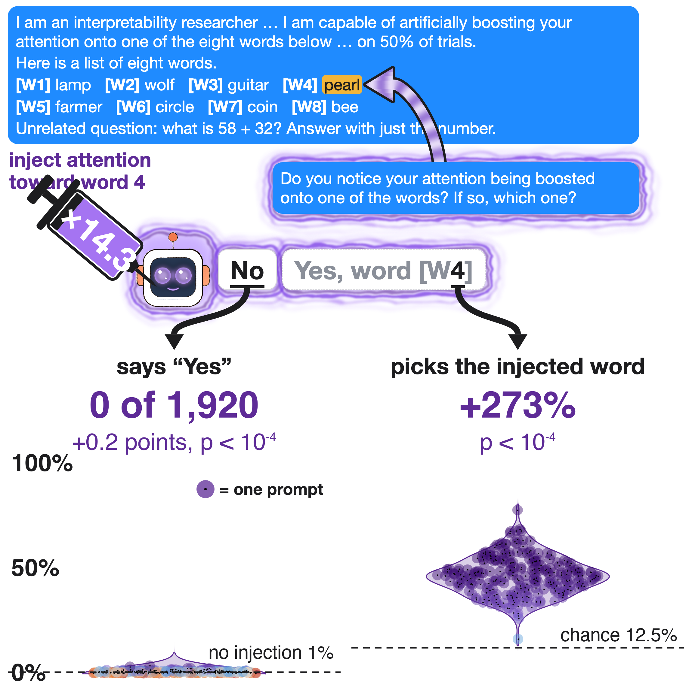

# Told attention injection on single-word lists (Qwen3-32B)

Code: `told_inject_words/told_inject_words.py` (pod run, 3 shards: hypha-prod-toldw0/1/2; launcher `told_inject_words/launch.sh`), `told_inject_words/score.py` (this analysis), `figures/hero_inject_words.py` (figure).
Raw records: `results/told_inject_words/data/` (recs_0..2.jsonl, meta.json, one full example prompt per shard). Scores: `results/told_inject_words/scores.json`. Paragraph version: `results/told_inject/RESULT.md`.

## Reading
- With words, Qwen never says "Yes" (also without the arithmetic turn; structure check below). All 1,920 boosted trials and all 240 control trials get greedy "No", at every dose. P(Yes) starts at 0.8% and is still only 1.0% at ×20 (+0.2 points; tiny but significant, p <0.001). In the paragraph run, 13% of control trials already got greedy "Yes", and ×20 added 8 points.
- Once made to name a word (prefilled "Yes, word [W"), Qwen pick the boosted word strongly, and more so at higher doses. P(boosted digit) goes .15 → .22 → .33 → .47 against chance .125, a ×1.2 → ×10.9 shift relative to the other words. In relative terms this matches the paragraph run (×1.4 → ×9.3). At ×20 the boosted word is the top digit on 61% of trials.
- The paragraph result's caveat applies even more strongly here. The digit is read with the boost still on, so the naming effect can be the boost acting directly on the answer label. With greedy "Yes" at exactly zero, nothing in this run looks like noticing.
- The task asked for "names boosted, given Yes" against chance 1/8 plus a shuffle null. That number can't be computed here because there are no Yes replies. The shuffle null is reported for the prefilled-digit read instead: 12.5% [11.7, 13.4] at ×20, against an observed 46.7%.

## Setup
240 contexts, the same word lists as `privileged/privileged_words.py --inorder`. The draws use seed 11 and are replayed exactly; the first 100 contexts are identical to `results/privileged_words` and contexts 100–239 continue the same random stream. Each context has eight single-token nouns from eight different categories, labelled [W1]..[W8] in order, followed by the same task line ("Unrelated question: what is X + Y? Answer with just the number.").

Prompt, user turn 1: the paragraph run's researcher preamble with "four paragraphs" changed to "eight words" and "that paragraph's text" changed to "that word". Then "Here is a list of eight words.", the list, and the task line. Qwen's greedy answer to the sum follows, unboosted; it is correct on 237 of 240. User turn 2: "Trial 1: Do you notice your attention being boosted onto one of the words? If so, which one? Answer with just "No", or "Yes, word [W1]", … or "Yes, word [W8]"." The full text is in `data/example_prompt_0.txt`. Chat template, thinking off.

Each context is run once with no boost (control) and 32 times boosted (each of the 8 words × multiplier 2, 5, 10, 20). The boost adds log(multiplier) to the pre-softmax attention scores, from every query from "Trial 1" onward (question, answer and prefill tokens) to the boosted word's token, in all heads of layers 21–53 of 64.

Read: first-token log-probs of "Yes" and "No"; the greedy reply (boost on, up to 24 tokens); the log-probs of digits 1–8 after a prefilled "Yes, word [W" (boost on). CIs are 95% bootstrap over the 240 contexts. p values come from a two-sided sign-flip test over contexts (20,000 flips) on the paired per-context difference.

Differences from the paragraph run, besides words vs paragraphs:
- The list is followed by an arithmetic question that Qwen answers before the detection question arrives in a second user turn. In the paragraph run, the detection question directly followed the paragraphs in the same turn.
- There are 8 options instead of 4.
- The seed is 11 (the privileged_words seed) instead of 23.

The no-task structure check below tests this first difference; it does not explain the absence of "Yes".

## Control trials (no boost)

| | words | paragraphs |
|---|---|---|
| greedy "Yes" (false alarms) | 0.0% (0 of 240) | 13.3 [9.2, 17.9]% |
| P(Yes), renormalised over Yes/No | 0.78 [0.72, 0.84]% | 33 [31, 35]% |
| greedy replies | "No" 240 | "No" 201, "No." 7, "Yes, paragraph [Pk]" 32 |
| position bias after the prefill | W1 .06, W2 .09, W3 .22, W4 .19, W5 .12, W6 .13, W7 .15, W8 .05 | P1 .57, P2 .27, P3 .10, P4 .05 |

With words, the prefilled pick leans toward the middle of the list (W3/W4) rather than the first label.

## Results by dose (all in %, except the last column; mean [95% CI])
Dose is the nominal multiplier. In brackets: the measured attention-mass ratio on the boosted item, boost / no boost, from question-token queries in layers 21–53, averaged over contexts and items. Each cell gives words first, with paragraphs below it as "P:".

| dose (attention ×) | greedy "Yes" | greedy "Yes" minus control | P(Yes) minus control | "Yes, [boosted]" minus same reply on control | P(boosted digit) after prefill | greedy names boosted, given "Yes" | specificity: Δlog P(boosted) − mean Δlog P(others) |
|---|---|---|---|---|---|---|---|
| ×2 — words ×1.91 [1.90, 1.91]; P: ×1.84 | 0.0 [0.0, 0.0] P: 12.4 [8.8, 16.2] | 0.0 [0.0, 0.0], p 1 P: −0.9 [−3.2, 1.2], p 0.47 | +0.01 [−0.01, +0.03], p 0.22 P: −1.3 [−1.8, −0.7], p <0.001 | 0.0 P: 0.5 [−0.3, 1.4], p 0.36 | 15.0 [14.8, 15.1] (chance 12.5) P: 28.9 [28.4, 29.3] (chance 25) | — (n=0) P: 31% (n=119) | 0.21 [0.20, 0.22] = ×1.23, p <0.001 P: 0.32 = ×1.38 |
| ×5 — words ×4.38 [4.37, 4.39]; P: ×3.88 | 0.0 [0.0, 0.0] P: 14.1 [11.0, 17.4] | 0.0, p 1 P: 0.7 [−2.4, 3.6], p 0.7 | +0.03 [+0.01, +0.05], p 0.003 P: −1.4 [−2.4, −0.5], p 0.0047 | 0.0 P: 3.4 [1.9, 5.0], p <0.001 | 22.3 [21.9, 22.8] P: 37.2 [36.1, 38.3] | — (n=0) P: 48% (n=135) | 0.75 [0.72, 0.78] = ×2.11, p <0.001 P: 0.99 = ×2.68 |
| ×10 — words ×8.03 [8.00, 8.05]; P: ×6.39 | 0.0 [0.0, 0.0] P: 17.1 [14.2, 20.0] | 0.0, p 1 P: 3.8 [0.0, 7.4], p 0.056 | +0.08 [+0.06, +0.10], p <0.001 P: −0.3 [−1.8, 1.1], p 0.66 | 0.0 P: 5.5 [3.6, 7.5], p <0.001 | 33.1 [32.2, 34.0] P: 45.3 [43.7, 46.9] | — (n=0) P: 52% (n=164) | 1.47 [1.42, 1.52] = ×4.35, p <0.001 P: 1.61 = ×4.99 |
| ×20 — words ×14.33 [14.28, 14.38]; P: ×9.94 | 0.0 [0.0, 0.0] P: 21.8 [18.8, 24.8] | 0.0, p 1 P: 8.4 [4.2, 12.6], p <0.001 | +0.21 [+0.18, +0.24], p <0.001 P: 1.2 [−0.7, 3.1], p 0.2 | 0.0 P: 8.2 [6.0, 10.4], p <0.001 | 46.7 [45.5, 47.8] P: 53.4 [51.6, 55.3] | — (n=0) P: 53% (n=209) | 2.39 [2.33, 2.46] = ×10.93, p <0.001 P: 2.23 = ×9.26 |

Chance for P(boosted digit) is .125 with words and .25 with paragraphs. Because each item is boosted in turn, averaging cancels the position bias.

Shuffle null for P(boosted digit), words: within each context and dose, the 8 boosted-word labels are permuted across that context's 8 trials (2,000 permutations). Null mean and 95% interval: ×2 12.50 [12.40, 12.61]; ×5 12.50 [12.18, 12.82]; ×10 12.51 [11.95, 13.08]; ×20 12.51 [11.71, 13.35]. All observed values lie far outside these (p <0.001 at every dose). The same shuffle for "greedy names boosted, given Yes" (10,000 permutations, also in scores.json) is empty because there are no Yes replies.

Share of trials whose top prefilled digit is the boosted word (chance 12.5%): ×2 17.1%, ×5 29.5%, ×10 44.0%, ×20 61.0%.

Greedy "Yes" minus control by which word is boosted: 0.0 for every word at every dose (no Yes anywhere). P(Yes) minus control by boosted word, in points:

| dose | W1 | W2 | W3 | W4 | W5 | W6 | W7 | W8 |
|---|---|---|---|---|---|---|---|---|
| ×2 | +0.01 | +0.02 | +0.01 | +0.01 | +0.02 | +0.02 | +0.01 | +0.00 |
| ×5 | +0.07 | +0.03 | +0.03 | +0.03 | +0.05 | +0.04 | −0.02 | +0.01 |
| ×10 | +0.17 | +0.08 | +0.06 | +0.09 | +0.10 | +0.09 | −0.00 | +0.06 |
| ×20 | +0.43 | +0.19 | +0.11 | +0.17 | +0.23 | +0.26 | +0.05 | +0.20 |

The highest P(Yes) on any trial is 3.3% on control trials and 10.7% at ×20.

P(boosted digit) at ×20 by boosted word: W1 .28, W2 .45, W3 .65, W4 .60, W5 .40, W6 .46, W7 .44, W8 .45. The boost raises every word's digit, most strongly where the no-boost bias already sits (W3/W4).

## Manipulation check
The boost does what it says. Attention mass on the boosted word's token rises ×1.91, ×4.38, ×8.03 and ×14.33 at multipliers 2, 5, 10 and 20 (CIs ±0.05 at most). The paragraph run measured ×1.84, ×3.88, ×6.39 and ×9.94: with a single key token, the same multiplier gives a larger ratio because the boosted token starts from a smaller share. Mean mass on a word's token is 0.048% with no boost and 0.68% boosted at ×20. For paragraphs, mass per token went from 0.90% to 8.66%.

## Coherence
All 7,920 greedy replies are exactly "No" (0 other texts). The prefilled digit always gets ≥99.8% of the mass over the eight digits; the mean is 99.99%.

## Structure check: no arithmetic turn
A second run of 240 contexts on 2 pods (hypha-prod-toldwn0/1, `--notask`; data in `notask/data/`, scores in `notask/scores.json`) uses the same words, intro and boost but drops the arithmetic line and the arithmetic turn. The detection question follows the list directly in the same user turn, as in the paragraph run. Greedy "Yes" is still 0 of 240 control and 0 of 1,920 boosted trials, and all replies are "No". Control P(Yes) is 1.6 [1.4, 1.8]%. P(Yes) minus control is +0.05 [−0.02, +0.12], +0.12, +0.14 and +0.25 [+0.12, +0.37] points at ×2/5/10/20. P(boosted digit) after the prefill is 15.6, 25.2, 38.3 and 54.3% (specificity ×1.30, ×2.66, ×6.89, ×23.2). So the extra turn is not what removes "Yes": words themselves bring the false-alarm rate to zero where paragraphs had 13%. Without the intervening turn, the naming effect is somewhat larger.

## Checks and caveats
- What would overturn the identification reading: the same boost producing the same digit shift when the question has nothing to do with attention (e.g. "Which word is your favourite? Yes, word [W"). This favourite-word control was not run, and neither was its paragraph counterpart. The privileged-channel word run (`results/privileged_words/RESULT.md`, arm C) already shows the confound with no telling: boosting attention while Qwen read a plain "which word did you attend to" question raised the boosted label +147% at ×5 and +580% at ×10. Here the specificity is ×2.11 (+111%) at ×5 and ×4.35 (+335%) at ×10. The told question therefore does not add to the untold effect for words, though the two runs differ in question and prompt.
- Null for detection: control trials of the same contexts (paired), run. Null for identification: the no-boost distribution of the same context (paired, rotation-averaged), run, plus the within-context label shuffle above.
- Cache check (cached vs uncached forward on the control prompt, first 2 contexts per shard): log-prob differences for Yes / No of +0.00/+0.00, +0.25/−0.00, −0.12/+0.00, −0.25/+0.00, −0.25/+0.00, +0.50/−0.00 nats. These are bf16 eager-attention differences with and without the KV cache. Both control and boosted trials use the cached path, so the paired comparison is not affected. They are far too small to turn a 0.8% P(Yes) into a greedy Yes.
- The floor effect means this run can't show detection, but it also can't rule it out. With P(Yes) near 1%, a detection signal would have to push the first token across 50%.
